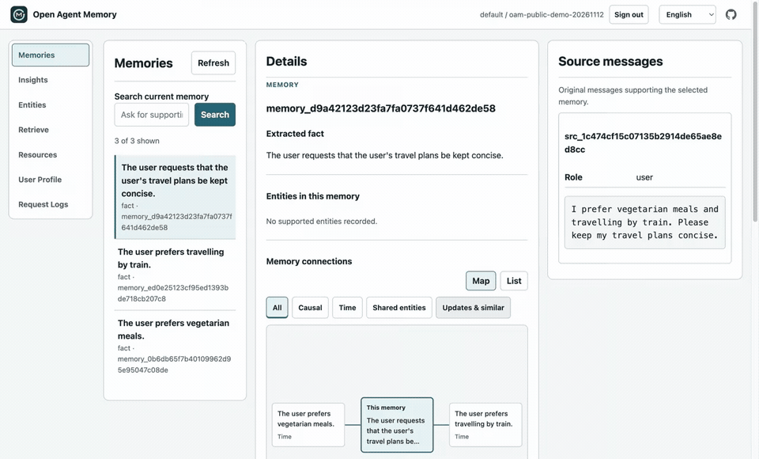

# Open Agent Memory

English (canonical) | [简体中文](README_CN.md) | [日本語](README_JA.md)

[First cited recall](docs/quickstart.md) · [MCP setup](integrations/mcp/README.md) · [Benchmark results and reproduction](docs/benchmarks.md)

[](https://github.com/rocke2020/open-agent-memory/releases/download/v0.0.1/oam-v0.0.1-cited-recall-demo.mp4)

[Watch the 71-second demo](https://github.com/rocke2020/open-agent-memory/releases/download/v0.0.1/oam-v0.0.1-cited-recall-demo.mp4): an existing synthetic memory, readiness and recall from a fresh MCP process, then the original source in Memory Inspector. The recording runs at 2× speed and reuses the completed index.

Connect an existing OAM deployment to your MCP client with Node.js 22+:

```json
{
  "mcpServers": {
    "oam": {
      "command": "npx",
      "args": ["-y", "@rocke-dong/oam-mcp@0.0.1"],
      "env": {
        "OAM_BASE_URL": "http://127.0.0.1:17333",
        "OAM_USER_ID": "your-user-id",
        "OAM_USER_API_KEY": "your-user-key"
      }
    }
  }
}
```

Use your own user-scoped key and keep the client configuration private. [Set up OAM first](deploy/README.md), then follow the [Claude Code and Cursor instructions](integrations/mcp/README.md#client-configuration).

## What Is Open Agent Memory?

Open Agent Memory (OAM) is an Apache-2.0 self-hosted memory engine for AI agents. It turns eligible conversations into source-backed facts and Insights, keeps documents as separate Resources, and retrieves both with citations. An explicitly refreshed User Profile helps agents carry useful personal context across sessions.

“Open” means the complete memory system: indexing, retrieval, Profiles, user controls and native multi-node operation are available in the Apache-2.0 core for developers to inspect, run, modify and improve.

Integrate through the HTTP API, the local [MCP server](integrations/mcp/README.md), or the OpenClaw and DeepSeek Harness plugins. The bundled Memory Inspector lets users browse memory, follow its sources, search Resources and manage what is retained.

## Why Open Agent Memory?

- **Fully open source, with native multi-node deployment.** Run stateless API replicas and durable workers across nodes over shared PostgreSQL/pgvector. Coordination, recovery and deployment code are part of the Apache-2.0 core.
- **Recall with evidence.** Retrieve facts and Insights together with supporting original passages and citations, so the agent can reason from the source.
- **Search conversations and documents together.** HTML, PDF and image Resources remain separate from learned personal memory while sharing one retrieval path.
- **Personalize when you choose.** Build a stored User Profile from eligible memory and explicit Profile Data on request; unchanged inputs reuse it without generation.
- **Inspect and control memory.** Browse sources in the Inspector, remove an individual Memory Unit or Insight, and manage document Resources through the same authorized API.
- **Control your data and models.** Self-host your memory in PostgreSQL/pgvector and configure your own model endpoints.

See the [acceptance requirements](docs/acceptance.md), [release evidence](docs/release-evidence.md) and [published release](https://github.com/rocke2020/open-agent-memory/releases/tag/v0.0.1) for verified behavior, deployment limits and artifacts.

## Get Started

Clone the repository and pull the published v0.0.1 image for Linux AMD64 or ARM64:

```bash
git clone https://github.com/rocke2020/open-agent-memory.git
cd open-agent-memory
docker pull ghcr.io/rocke2020/open-agent-memory:0.0.1
```

Follow the [Docker Compose guide](deploy/README.md) to configure PostgreSQL and your model endpoints, initialize OAM and open the Memory Inspector. Set `OAM_IMAGE=ghcr.io/rocke2020/open-agent-memory:0.0.1` in `deploy/.env` to use the published image.

Integrate through the [HTTP API](docs/api.md), the [MCP server](integrations/mcp/README.md), or the [OpenClaw](integrations/openclaw/README.md#npm-installation) or [DeepSeek Harness](integrations/dsh/README.md) plugin. Start with the [copyable retain → readiness → recall example](docs/quickstart.md) to store a conversation, wait for indexing and inspect the returned source citations.

## Performance & Accuracy

**OAM achieved 94.0% accuracy (470/500) on LongMemEval S (LME-500)** using `deepseek-v4.1-flash` for extraction, answering and judging, reflecting everyday agent workloads. Fast recall supplied **12.4K tokens of answer context on average**. The result includes the recorded single-retry policy. See the [LME-500 results and per-question evidence](https://github.com/rocke2020/open-agent-memory-benchmark/tree/main/eval_results/lme500).

For large-volume memory workloads, OAM reached a **61.56% mean rubric score on BEAM-10M** with DeepSeek Flash (saved answer/judge binding `deepseek-flash`). Our [evaluation](https://github.com/rocke2020/open-agent-memory-benchmark/tree/main/eval_results/beam10m) uses **10 full, untruncated conversation histories, each exceeding 10 million tokens**, with **200 questions** to test recall quality and retrieval performance over long histories.

We chose DeepSeek Flash to control evaluation costs and show memory performance with an everyday agent model, rather than optimize the headline with a top model. These are the completed v0.0.1 development results. Scores reflect retrieval, the answer model and the judging policy together; complex tasks also depend on the model's reasoning. They do not establish a ranking against other systems or measure the gains from a stronger answer model. The linked reports provide the evaluated revisions, settings, retry policy and complete answer contexts.

See the [standalone benchmark page](docs/benchmarks.md) for both result tables, model settings, configuration identities and commands to reproduce the published measurements.

## Product Model

- **L0 Source evidence:** retained eligible conversations with roles, times, source identities, and learning eligibility.
- **L1 Learned memory:** source-linked facts, preferences, experiences, events, and constraints extracted from eligible interactions.
- **L2 Insights:** persisted synthesis over related eligible L1 records with transitive L0 support and one descriptive subtype: `preferences`, `patterns`, `projects`, `relationships`, `experiences` or `general_insights`; subtype does not alter ranking.
- **L3 User Profile:** one explicitly refreshed, read-only document built from Profile Data and eligible Learned Memory; unchanged inputs reuse it with zero generation calls.
- **Profile Data:** explicitly supplied structured basic information or preferences, mapped to exact User Profile inputs and excluded from ordinary recall.
- **Resources:** retained text/HTML/PDF/image originals, detailed passages, locators, and abstracts that remain searchable evidence and never automatically become L1–L3.

In `api_key` mode, one credential-derived tenant and one key-bound `user_id` identify a personal memory collection. An administrator creates it with `POST /v1/users` and receives that user's first key once; the host uses the user key for `POST /v1/retain` interactions, `POST /v1/users/{user_id}/resources` document originals, `POST /v1/users/{user_id}/profile-data` structured user inputs, and `POST /v1/recall`. The administrator key cannot read or write personal content directly. Local `dev` mode admits requests without a key and makes no privacy claim; `trusted` mode uses gateway-asserted tenant/user headers, with a root key required on nonlocal requests. Interactions need no caller-managed source/message IDs. Documents use a stable `document_id` with explicit `replace` or text-only `append`; OAM allocates revisions. The [HTTP API](docs/api.md) documents mode selection, JSON and multipart examples, user-key rotation, retry keys and operation readiness.

Recall uses one limit on the complete rendered context: `search.fast.context_max_tokens: 18000` and `search.normal.context_max_tokens: 32768`. Chunks are included by default; `include.chunks: false` omits full original bodies while retaining eligible learned text, required supporting facts and citations. Relevance determines admission across learned evidence and originals, including originals with no extracted facts. Complete evidence groups must fit without clipping; shared source chunks are counted once. If the only eligible L1 fact and its complete support exceed the total, return that bundle alone only when no higher-ranked root has been admitted, stop filling and report the overshoot. Insights have no such exception. `context_tokens` counts the complete returned text, including citations and metadata, with the local `o200k_base` tokenizer. It is not provider usage; hosts count their final composed model input separately.

## Architecture

OAM uses Python, FastAPI, explicit SQL through psycopg, and PostgreSQL with pgvector. API processes are stateless; PostgreSQL owns accepted originals, authorization, source lifecycle, operations, worker claims, leases, fences, and application-replica recovery. Each service uses one configured VLM through OpenAI Chat, OpenAI Responses or Anthropic Messages, with per-role reasoning effort and separate embedding and optional reranker models. There are no provider, model, endpoint, or credential defaults.

```text
trusted application -> user-authorized retain -> PostgreSQL receipt + immutable original
                                      |
                                      v
                               durable workers
                         interactions -> L0 -> L1 -> L2
                         Resources -> passages + abstract
                                      |
                                      v
                         joint fast/normal recall + citations

explicit User Profile refresh -> unchanged: zero calls
                         -> changed: durable operation -> L3
```

See [architecture](docs/architecture.md), [HTTP API](docs/api.md), [configuration guide](configs/README.md), [operations](docs/operations.md), the [Memory web UI guide](docs/memory-web-ui.md), [acceptance](docs/acceptance.md), and the current [Steps 1–4 foundation evidence](docs/foundation-evidence.md).

## Development Setup

Python 3.12–3.14 and `uv` are required.

```bash
uv sync --locked
uv run pytest -q
uv run ruff check .
uv run ruff format --check .
uv run oam preflight --config configs/oam.yaml --json
```

The canonical configuration defines one shared `models.vlm`, plus a separate `models.embedding`. Select `openai_chat`, `openai_responses`, or `anthropic_messages` as the generation protocol, and configure the model, endpoint and credential through private environment variables. `models.reasoning_effort` enables each role with `none`, `low`, `high` or `max`; YAML null disables that role. The VLM reasoning mode determines which settings are sent. Preflight exercises enabled text and vision roles with the selected protocol; actual model capabilities depend on the endpoint. See [model configuration](docs/operations.md) for protocol paths and reasoning options. Default tests never read private `.env` or contact external providers.

Run the API with its embedded durable worker using the operator configuration:

```bash
uv run oam api --config configs/oam.yaml --host 127.0.0.1
```

The default `worker.embedded_enabled: true` requires the API, queue and worker-content DSNs. For separate worker processes, set `worker.embedded_enabled: false` in the operator YAML and run `oam api` and `oam worker` with that file. Each runner uses the canonical `worker.max_tasks` limit, currently ten task slots; deployment tooling controls process count. Shared PostgreSQL admission bounds generation, embeddings and HTTP traffic independently of replica count; see [operations](docs/operations.md#4-limits-and-failure-ownership).

`GET /health/live`, `GET /health/ready`, `GET /v1/capabilities`, `/openapi.json`, and `/ui/` are available. Readiness returns `200` when the bounded database/schema, enabled-model configuration, admission and applicable worker checks succeed, or `503` with a reason. It makes no model calls and does not certify model quality or release readiness. Configure distinct API, queue and worker-content DSNs plus extraction, Insight, embedding and abstract model roles before using the core; delegated search also needs an optional planner binding. On a fresh database, `oam migrate` selects rootless local `dev` when no root secret or handoff destination is supplied; set `OAM_ROOT_API_KEY` or `OAM_BOOTSTRAP_OUTPUT` to initialize a keyed deployment. See [operations](docs/operations.md). Batch search and optional one-call delegated search use the existing recall path; Resource/source controls, recorded debug, export validation and the browser Inspector are documented in the [HTTP API](docs/api.md). The stored User Profile uses `/profile`; document Resources use `/resources`, and structured Profile Data uses `/profile-data`; User Profile generation requires its configured model role.

## Release Boundary

v0.0.1 requires all L0–L3 layers, separate Resource ingestion, fast/normal joint recall, source lifecycle, explain/diff/recorded replay, portable export, Memory Inspector, multi-API/multi-worker recovery, conformance evidence, and a public multi-architecture image. Fast and normal are the supported recall modes. The Python SDK, supplier importers, full User Profile Studio, hosted service, database HA, and multi-region operation are later work.

The [Docker/Compose guide](deploy/README.md) uses one non-root API/worker image, bundled Inspector assets and PostgreSQL/pgvector. The replica example simulates two APIs and two workers locally; it does not establish physical multi-host resilience. [OpenClaw](integrations/openclaw/README.md) and [DSH](integrations/dsh/README.md) install from npm, with OpenClaw also available on ClawHub and versioned plugin tarballs retained for reproducibility. Public release and image availability are separate from local candidate verification.

## Acknowledgments

We thank the contributors to [Hindsight](https://github.com/vectorize-io/hindsight), [OpenViking](https://github.com/volcengine/OpenViking), [Mem0](https://github.com/mem0ai/mem0), [MemOS](https://github.com/MemTensor/MemOS) and [TencentDB Agent Memory](https://github.com/TencentCloud/TencentDB-Agent-Memory) for their open-source work, which informed OAM. See the [full acknowledgments](ACKNOWLEDGMENTS.md) and [third-party notices](THIRD_PARTY.md) for project, benchmark and license credits.

## License

Apache License 2.0. See [LICENSE](LICENSE) and [THIRD_PARTY.md](THIRD_PARTY.md).
