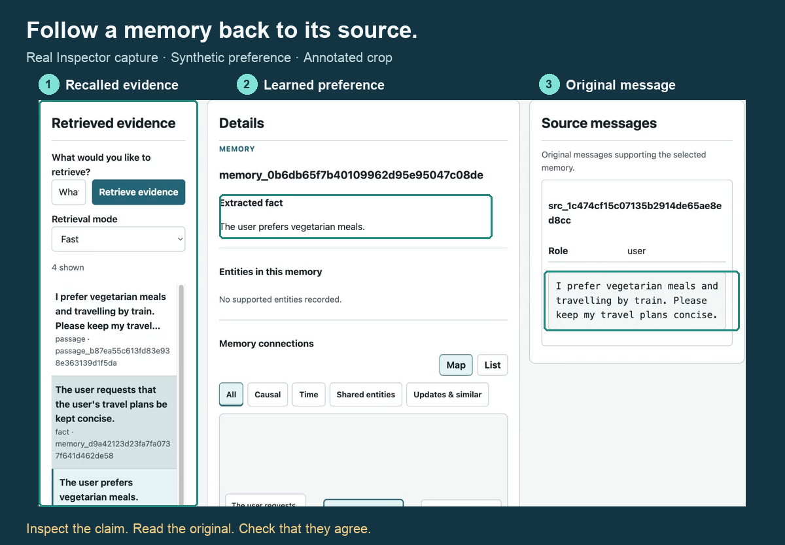

# Open Agent Memory

**Useful memory for everyday AI agents.**

[English](README.md) | [中文](README_CN.md) | [日本語](README_JA.md)

[Get started](#quick-start) · [Performance](#performance--accuracy) · [Integrations](#connect-your-agent) · [Documentation](docs/indexing-retrieval.md) · [Releases](https://github.com/rocke2020/open-agent-memory/releases)

Open Agent Memory (OAM) is a fully open-source memory engine for AI agents. It remembers useful facts, preferences and experiences across conversations, then retrieves relevant evidence with citations when your agent needs it.

Keep your conversations and documents in your own PostgreSQL database, choose your model providers, and inspect what the agent remembers. OAM supplies the memory; your agent writes the answer.

## Performance & Accuracy

**State-of-the-art against AMB's published results for LongMemEval S and BEAM-10M.** OAM exceeds the top recorded Hindsight scores on both full datasets using low-cost **MiniMax M3.1 Flash** adaptive for answering and judging. [AMB results manifest](https://github.com/vectorize-io/agent-memory-benchmark/blob/c963dba91dfe6c459f64bb871c5dafb2f3de1bf1/results-manifest.json)

| Benchmark | OAM | Published Hindsight | Mean saved answer context |
| --- | --- | --- | --- |
| **BEAM-10M**, mean rubric credit | **78.23%** | 64.08% | **24,676.88** vs 27,373.25 tokens (**9.85% fewer**) |
| **BEAM-10M**, pass rate (score ≥ 0.5) | **86.0% (172/200)** | 73.5% (147/200) | |
| **LongMemEval S**, accepted answers | **95.2% (476/500)** | 94.6% (473/500) | **11,373.58** vs 43,124.55 tokens (**73.63% fewer**) |

BEAM-10M tests reasoning over ten histories at the **10-million-token scale**, including event ordering, temporal reasoning and reconciling contradictions. OAM gained **14.15 points in mean rubric credit and 25 additional passes**. For 180 current recalls, OAM capped native context at **24,000 tokens**. The full result also includes 20 previously saved contexts. [BEAM method and results](docs/benchmarks.md#3-beam-10m)

**For a fair comparison, both benchmarks use the same questions, reference answers and scoring rules as the published Hindsight runs.** OAM reuses byte-identical answer and judge prompt templates from the pinned AMB sources. Three BEAM judge calls needed a JSON example in the provider wrapper. The judge text and scoring rule stayed the same. [LongMemEval settings](docs/benchmarks.md#1-latest-longmemeval-s-476500-at-18k) · [BEAM protocol](docs/benchmarks.md#3-beam-10m)

The recorded comparisons measure end-to-end results with different models and memory pipelines. Saved text is counted with `o200k_base`. The LME mean uses 497 current contexts, and three disputed-gold cases still count as incorrect in the 500-question score. MiniMax lists USD 0.15 per million uncached input tokens and USD 0.60 per million output tokens. [Official MiniMax pricing](https://platform.minimax.io/docs/pricing/overview#llm)

Scores can vary when answer and judge models are rerun. In a [same-input MiniMax example](docs/benchmarks.md#answer-and-judge-variability), one answer was correct and another was incorrect; this illustrates observed variability, not its frequency.

[Results, model pricing and methodology](docs/benchmarks.md) · [LME per-question evidence](https://github.com/rocke2020/open-agent-memory-benchmark/tree/main/eval_results/lme500-20261117) · [BEAM per-question evidence](https://github.com/rocke2020/open-agent-memory-benchmark/tree/main/eval_results/beam10m-20261119)

## Why OAM?

- **Remember across sessions.** Retain useful preferences, decisions and experiences so your agent can use them in a new conversation.
- **Check the evidence.** Recalled memories link back to original source messages. Browse and remove memory through the Memory Inspector.
- **Search conversations and documents together.** Recall relevant learned memory alongside text, HTML, PDF and image Resources; documents stay separate from learned personal memory.
- **Build a useful personal Profile.** Explicitly refresh a stored User Profile from eligible memory and structured Profile Data.
- **Own your data and models.** Self-host with PostgreSQL/pgvector, configure your own endpoints, and control the recall context budget.

## Quick Start

You need **Docker with Compose**, **Git**, a generation endpoint that supports text and image inputs, and an OpenAI-compatible embedding endpoint. OAM has no default model endpoints or credentials. Model preflight and indexing use your configured providers and may incur charges.

### 1. Prepare your settings

```bash
git clone https://github.com/rocke2020/open-agent-memory.git
cd open-agent-memory
cp deploy/.env.example deploy/.env
```

Edit `deploy/.env`:

- Set `VLM_BASE_URL`, `VLM_API_KEY`, `VLM_MODEL` and `OAM_EMBEDDING_URL`, `OAM_EMBEDDING_KEY`, `OAM_EMBEDDING_MODEL` to your provider settings.
- Set each database password and `OAM_ROOT_API_KEY` to a separate random value; generate each with `openssl rand -hex 24`.
- The default embedding dimension is **1024**. If your endpoint returns a different supported size, set `index.embedding_dimensions` in `deploy/oam.yaml` **before initialization**. See [model configuration](docs/operations.md#1-configuration).

### 2. Start OAM

```bash
docker compose --env-file deploy/.env -f deploy/compose.yaml up -d --wait postgres
docker compose --env-file deploy/.env -f deploy/compose.yaml run migrate
docker compose --env-file deploy/.env -f deploy/compose.yaml exec -T postgres psql -U postgres -d oam -f /bootstrap/runtime-roles.sql
docker compose --env-file deploy/.env -f deploy/compose.yaml run api preflight --json
docker compose --env-file deploy/.env -f deploy/compose.yaml up -d --wait api worker
```

Stop if a command fails and resolve the reported error before continuing. The Compose file selects the **v0.1.0** image for Linux AMD64 or ARM64. See the [deployment guide](deploy/README.md) for ports, model servers on your host, source builds and replica setup.

### 3. Store and recall your first memory

Open the **Memory Inspector at <http://127.0.0.1:17333/ui/>**. Follow [Create your personal collection](docs/start-here.md#2-create-your-personal-collection), then [Store and recall a preference](docs/start-here.md#3-store-and-recall-a-preference): create a user key, retain a small preference, wait for indexing, and retrieve it with citations.

Your first success is a recalled preference whose citation leads to the original message. Then connect your agent and ask it to use that preference in a fresh session.

**[Complete first-memory walkthrough →](docs/start-here.md)**

## Connect Your Agent

Start the service and create a user key first. Client packages connect to OAM; they do not start the server.

| Agent or application | Integration |
| --- | --- |
| Claude Code or Cursor | [MCP server and client configuration](integrations/mcp/README.md#client-configuration), Node.js 22+ |
| OpenClaw | [Plugin installation](integrations/openclaw/README.md#npm-installation), with automatic recall and eligible capture |
| DeepSeek Harness (DSH) | [DSH plugin](integrations/dsh/README.md) |
| Your own application | [Copyable HTTP example](docs/quickstart.md) and [API reference](docs/api.md) |

## See What Your Agent Remembers



The Inspector lets you browse retained sources, inspect recalled memories and citations, manage Resources, and refresh your User Profile. This screenshot uses synthetic demonstration data. [Inspector guide](docs/memory-web-ui.md).

## How Memory Works

OAM preserves original conversations (**L0**), extracts source-backed facts (**L1**), and builds supported Insights across related facts (**L2**). An explicitly refreshed User Profile (**L3**) helps the agent personalize its behavior. Text, HTML, PDF and image **Resources** remain separate evidence and can be retrieved alongside learned memory.

Recall supports **fast** and **normal** modes and returns cited context without generating the final answer. The default context limits are 18,000 and 24,000 tokens respectively. Your agent decides how to use that evidence and owns its final answer and total input budget.

[Memory and retrieval design](docs/indexing-retrieval.md) · [Architecture](docs/architecture.md) · [Configuration](configs/README.md)

## v0.1.0

This release marks the retrieval-quality milestone above: higher recorded benchmark scores with low-cost Flash models and compact LME context. It improves source-evidence selection and context formatting, lowers the normal context default to 24,000 tokens, and adds opt-in fast scoring and experimental source-body policies. Existing indexes can be reused; no new migration or reindexing is required when upgrading from v0.0.3.

See the [release notes and upgrade guide](docs/releases/0.1.0.md) for verification and publication status. OpenClaw remains independently versioned at 0.0.2; MCP and DSH remain at 0.0.1.

## Documentation & Development

| Goal | Guide |
| --- | --- |
| Deploy or upgrade OAM | [Docker Compose](deploy/README.md) |
| Store and recall through HTTP | [Quickstart](docs/quickstart.md) · [API reference](docs/api.md) |
| Configure providers and operate the service | [Operations](docs/operations.md) |
| Understand verified behavior and limits | [Acceptance](docs/acceptance.md) · [Release notes](docs/releases/0.1.0.md) |
| Build, test or contribute | [Contributing](CONTRIBUTING.md) · [Release procedure](docs/releasing.md) |

Future work includes smoother onboarding, lower indexing and answer-context token usage, and shared Resource ownership. The Python SDK, hosted service, database high availability and OIDC/LDAP support remain future work. Share setup and retrieval feedback in [Discussions](https://github.com/rocke2020/open-agent-memory/discussions/1).

## Acknowledgments

OAM is informed by open-source work from [Hindsight](https://github.com/vectorize-io/hindsight), [OpenViking](https://github.com/volcengine/OpenViking), [Mem0](https://github.com/mem0ai/mem0), [MemOS](https://github.com/MemTensor/MemOS), [TencentDB Agent Memory](https://github.com/TencentCloud/TencentDB-Agent-Memory) and [gbrain](https://github.com/garrytan/gbrain). We thank the [LongMemEval](https://github.com/xiaowu0162/LongMemEval) and [BEAM](https://github.com/mohammadtavakoli78/BEAM) authors and contributors. See [full acknowledgments](ACKNOWLEDGMENTS.md) and [third-party notices](THIRD_PARTY.md).

## License

[Apache License 2.0](LICENSE).
