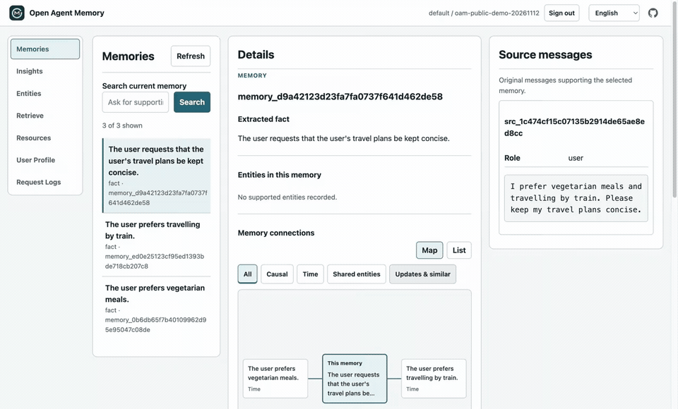

# Open Agent Memory

[English（权威版本）](README.md) | 简体中文 | [日本語](README_JA.md)

Open Agent Memory（OAM）是完全开源的 AI Agent 记忆引擎。它将符合长期记忆的会话转化为有来源支撑的事实与洞察（Insights），将文档作为独立资源（Resources）保存，并在检索两者时返回来源引用。显式刷新的用户画像（User Profile）帮助 Agent 在不同会话之间保留有用的个人上下文。

## 性能与准确率

我们选择 **DeepSeek Flash** 来控制评估成本，并展示使用日常 Agent 工作模型时的记忆性能。已完成的 v0.0.1 开发评估采用**首次高推理强度回答、符合条件时至多进行一次最大推理强度重试**的策略，并使用高推理强度评判，覆盖 **500 道 LongMemEval S 问题**和 **200 道 BEAM-10M 问题**。

### 已记录的 DeepSeek 评估结果

| 评估 | OAM | 使用 DeepSeek 的 Hindsight | 观察到的差异 |
|---|---|---|---|
| [LME-500：回答准确率](https://github.com/rocke2020/open-agent-memory-benchmark/tree/32bf1921f0db7c8f0008428b06b637c1f93ff385/eval_results/lme500) | **94%（470/500）** | 89.6%（448/500） | **+4.4 个百分点** |
| [BEAM-10M：评分量表平均得分](https://github.com/rocke2020/open-agent-memory-benchmark/tree/32bf1921f0db7c8f0008428b06b637c1f93ff385/eval_results/beam10m) | **61.56%** | 52.16%（已保存上下文重放） | **+9.40 个百分点** |

**LME 比较：** OAM 使用 DeepSeek Flash，并采用上述首次高推理强度回答、最大推理强度重试策略；[完整的 Hindsight 复现](https://github.com/rocke2020/agent-memory-benchmark/tree/b6eac3dbd41de03fb6ac31486b342f4d1b556dde)使用 DeepSeek V4 Flash 0731 进行抽取和评判，使用 V4 Pro 0813 生成回答。模型版本和回答生成设置存在差异。

**BEAM 比较：** 两组在相同的 200 道问题上采用相同的 DeepSeek Flash 回答与评判策略。Hindsight 使用已保存的上下文重放，没有重新运行其引擎。OAM 使用的回答上下文多 17.43%。详见[比较方法与逐题证据](https://github.com/rocke2020/open-agent-memory-benchmark/blob/32bf1921f0db7c8f0008428b06b637c1f93ff385/eval_results/beam10m/README.md)。

LME-500 使用 fast 召回，**回答上下文平均为 12.4K tokens**。BEAM-10M 测试了 **10 段完整、未截断的会话历史**，每段历史有 20 道问题。链接中的报告记录了每次运行使用的模型绑定。

这些历史开发运行使用 L1 记忆评估检索、回答和评判；L2 洞察、用户画像和文档资源未纳入评分。

评估方法、模型设置、上下文计数、被评估版本、限制以及每道问题保留的证据，详见[基准结果与复现](docs/benchmarks.md)。

[首次带引用的召回](docs/quickstart.md) · [MCP 设置](integrations/mcp/README.md) · [基准结果与复现](docs/benchmarks.md)

[](https://github.com/rocke2020/open-agent-memory/releases/download/v0.0.1/oam-v0.0.1-cited-recall-demo.mp4)

[观看 71 秒演示](https://github.com/rocke2020/open-agent-memory/releases/download/v0.0.1/oam-v0.0.1-cited-recall-demo.mp4)：使用已有的合成记忆，从新启动的 MCP 进程检查就绪状态并进行召回，然后在 Memory Inspector 中查看原始来源。录制内容以 2× 速度播放，并复用已完成的索引。

使用 Node.js 22+ 将已有的 OAM 部署连接到 MCP 客户端：

```json
{
  "mcpServers": {
    "oam": {
      "command": "npx",
      "args": ["-y", "@rocke-dong/oam-mcp@0.0.1"],
      "env": {
        "OAM_BASE_URL": "http://127.0.0.1:17333",
        "OAM_USER_ID": "your-user-id",
        "OAM_USER_API_KEY": "your-user-key"
      }
    }
  }
}
```

使用你自己的用户级密钥，并将客户端配置保密。[先设置 OAM](deploy/README.md)，然后按照 [Claude Code 和 Cursor 说明](integrations/mcp/README.md#client-configuration)操作。

## 什么是 Open Agent Memory？

“Open”意味着完整的记忆系统：索引、检索、用户画像、用户控制以及原生多节点运行能力均可供开发者检查、运行、修改和改进。

通过 HTTP API、[本地 MCP 服务](integrations/mcp/README.md)，或 OpenClaw 与 DeepSeek Harness 插件接入。内置的 Memory Inspector 可让用户浏览记忆、追溯来源、搜索文档资源，并管理保留的内容。

## 为什么选择 Open Agent Memory？

- **完整开源，原生支持多节点部署。** 基于共享 PostgreSQL/pgvector，跨节点运行无状态 API 副本和持久化 Worker。包含协调、恢复和部署代码。
- **有证据支撑的召回。** 同时检索事实、洞察及其原始支持片段和引用，让 Agent 能基于来源进行推理。
- **统一搜索会话与文档。** HTML、PDF 和图片资源与学习得到的个人记忆保持分离，同时使用统一的检索路径。
- **按需个性化。** 显式请求后，根据符合条件的记忆和明确提供的画像数据生成并保存用户画像；输入不变时直接复用，无需生成。
- **检查和控制记忆。** 在 Inspector 中浏览来源，删除单条记忆单元或洞察，并通过同一套经过授权的 API 管理文档资源。
- **掌控数据和模型。** 将记忆自托管于 PostgreSQL/pgvector，并配置自己的模型端点。

已验证的行为、部署限制和交付物见[验收要求](docs/acceptance.md)、[发布证据](docs/release-evidence.md)和[已发布版本](https://github.com/rocke2020/open-agent-memory/releases/tag/v0.0.1)。

## 快速开始

克隆仓库并拉取适用于 Linux AMD64 或 ARM64 的 v0.0.1 已发布镜像：

```bash
git clone https://github.com/rocke2020/open-agent-memory.git
cd open-agent-memory
docker pull ghcr.io/rocke2020/open-agent-memory:0.0.1
```

按照 [Docker Compose 指南](deploy/README.md)配置 PostgreSQL 和模型端点，初始化 OAM 并打开 Memory Inspector。将 `OAM_IMAGE=ghcr.io/rocke2020/open-agent-memory:0.0.1` 设置到 `deploy/.env` 中，即可使用已发布镜像。

通过 [HTTP API](docs/api.md)、[本地 MCP 服务](integrations/mcp/README.md)接入，或安装 [OpenClaw](integrations/openclaw/README.md#npm-installation) 或 [DeepSeek Harness](integrations/dsh/README.md) 插件。先运行[可复制的写入 → 等待就绪 → 召回示例](docs/quickstart.md)，保存会话、等待索引完成并检查返回的来源引用。

## 产品模型

- **L0 来源证据：** 保留符合条件的会话，包括角色、时间、来源标识和学习资格。
- **L1 学习记忆：** 从符合长期记忆的交互中抽取、与来源关联的事实、偏好、经历、事件和约束。
- **L2 洞察（Insights）：** 对相关且符合条件的 L1 记录进行综合并持久化，通过支持链追溯至 L0；每条洞察具有一个描述性子类型：`preferences`、`patterns`、`projects`、`relationships`、`experiences` 或 `general_insights`，子类型不影响排名。
- **L3 用户画像（User Profile）：** 根据画像数据和符合条件的学习记忆构建、显式刷新且只读的单一文档；输入不变时直接复用，生成模型调用次数为零。
- **画像数据（Profile Data）：** 明确提供的结构化基本信息或偏好，映射为精确的用户画像输入，不参与普通召回。
- **文档资源（Resources）：** 保留的文本、HTML、PDF 或图片原件，以及详细片段、定位信息和摘要；它们始终是可检索证据，不会自动成为 L1–L3。

在 `api_key` 模式下，由凭据确定的租户与用户密钥绑定的 `user_id` 共同标识一个个人记忆集合。管理员通过 `POST /v1/users` 创建用户，并仅在创建时收到该用户的首个密钥；宿主应用使用用户密钥调用 `POST /v1/retain` 写入交互、调用 `POST /v1/users/{user_id}/resources` 写入文档原件、调用 `POST /v1/users/{user_id}/profile-data` 写入结构化用户输入，并调用 `POST /v1/recall` 召回。管理员密钥不能直接读写个人内容。本地 `dev` 模式允许不带密钥的请求，不提供隐私保证；`trusted` 模式使用网关声明租户和用户身份的请求头，非本地请求需要根密钥。交互写入不要求调用方管理来源或消息 ID。文档使用稳定的 `document_id`，并显式选择 `replace` 或仅适用于文本的 `append`；修订版本由 OAM 分配。[HTTP API](docs/api.md) 说明了模式选择、JSON 和 multipart 示例、用户密钥轮换、重试键和操作就绪状态。

召回对完整渲染后的上下文使用单一上限：`search.fast.context_max_tokens: 18000` 和 `search.normal.context_max_tokens: 32768`。默认包含原文片段；设置 `include.chunks: false` 会省略完整原文正文，但保留符合条件的学习文本、必需的支持事实和引用。学习证据与原文均按相关性接纳，包括没有抽取出事实的原文。完整证据组必须在预算内整体放入，不能截断；共享来源片段只计数一次。如果唯一符合条件的 L1 事实及其完整支持材料超出总上限，且此前尚未接纳排名更高的主结果，则仅返回这一证据组、停止继续填充，并报告超出量。洞察不适用这一例外。`context_tokens` 使用本地 `o200k_base` tokenizer 统计完整返回文本，包括引用和元数据。它不等于供应商用量；宿主应用应另行统计最终组合后的模型输入。

## 架构

OAM 使用 Python、FastAPI、通过 psycopg 编写的显式 SQL，以及带 pgvector 的 PostgreSQL。API 进程无状态；PostgreSQL 负责已接受的原件、授权、来源生命周期、操作、Worker 任务认领、租约、隔离令牌（fence）以及应用副本恢复。每个服务通过 OpenAI Chat、OpenAI Responses 或 Anthropic Messages 使用一个配置的 VLM，可按角色设置推理强度，并单独配置 embedding 模型和可选的 reranker 模型。系统不提供默认供应商、模型、端点或凭据。

```text
trusted application -> user-authorized retain -> PostgreSQL receipt + immutable original
                                      |
                                      v
                               durable workers
                         interactions -> L0 -> L1 -> L2
                         Resources -> passages + abstract
                                      |
                                      v
                         joint fast/normal recall + citations

explicit User Profile refresh -> unchanged: zero calls
                         -> changed: durable operation -> L3
```

详见[架构](docs/architecture.md)、[HTTP API](docs/api.md)、[配置指南](configs/README.md)、[运维](docs/operations.md)、[Memory Web UI 指南](docs/memory-web-ui.md)、[验收](docs/acceptance.md)以及当前的[步骤 1–4 基础证据](docs/foundation-evidence.md)。

## 开发环境

需要 Python 3.12–3.14 和 `uv`。

```bash
uv sync --locked
uv run pytest -q
uv run ruff check .
uv run ruff format --check .
uv run oam preflight --config configs/oam.yaml --json
```

权威配置定义共享的 `models.vlm` 和独立的 `models.embedding`。选择 `openai_chat`、`openai_responses` 或 `anthropic_messages` 作为生成协议，并通过私有环境变量配置模型、端点和凭据。`models.reasoning_effort` 可用 `none`、`low`、`high` 或 `max` 为各角色启用相应设置；YAML null 会禁用该角色。VLM 的推理模式决定实际发送哪些参数。Preflight 使用所选协议检查已启用的文本和视觉角色；实际模型能力取决于端点。协议路径和推理选项见[模型配置](docs/operations.md)。默认测试不会读取私有 `.env`，也不会访问外部供应商。

使用运维配置运行 API 及其内嵌的持久化 Worker：

```bash
uv run oam api --config configs/oam.yaml --host 127.0.0.1
```

默认的 `worker.embedded_enabled: true` 要求配置 API、队列和 Worker 内容访问所用的 DSN。要使用独立 Worker 进程，在运维 YAML 中设置 `worker.embedded_enabled: false`，并使用该文件分别运行 `oam api` 和 `oam worker`。每个运行器都使用权威配置中的 `worker.max_tasks` 限制，当前为十个任务槽；进程数量由部署工具控制。共享的 PostgreSQL 准入机制对生成、embedding 和 HTTP 流量施加限制，不随副本数量增加而放大，详见[运维](docs/operations.md#4-limits-and-failure-ownership)。

系统提供 `GET /health/live`、`GET /health/ready`、`GET /v1/capabilities`、`/openapi.json` 和 `/ui/`。就绪检查在有界的数据库与 schema、已启用模型配置、准入机制以及适用的 Worker 检查成功时返回 `200`，否则返回 `503` 并说明原因。它不调用模型，也不证明模型质量或发布就绪。使用核心功能前，需要配置独立的 API、队列和 Worker 内容 DSN，以及抽取、洞察、embedding 和摘要模型角色；委托搜索还需要可选的 planner 绑定。在新数据库上，如果既未提供根密钥也未提供密钥交接目标，`oam migrate` 会选择无根密钥的本地 `dev` 模式；设置 `OAM_ROOT_API_KEY` 或 `OAM_BOOTSTRAP_OUTPUT` 可初始化带密钥的部署。详见[运维](docs/operations.md)。批量搜索和可选的单次调用委托搜索复用已有召回路径；文档资源与来源控制、已记录的调试信息、导出校验以及浏览器 Inspector 见 [HTTP API](docs/api.md)。保存的用户画像使用 `/profile`，文档资源使用 `/resources`，结构化画像数据使用 `/profile-data`；生成用户画像需要配置对应模型角色。

## 发布范围

v0.0.1 要求包含全部 L0–L3 层、独立的文档资源摄入、fast/normal 统一召回、来源生命周期、解释与差异比较及已记录结果的重放、可移植导出、Memory Inspector、多 API/多 Worker 恢复、一致性验收证据以及公开的多架构镜像。支持的召回模式为 fast 和 normal。Python SDK、供应商导入器、完整的用户画像工作台、托管服务、数据库高可用和多地域运行属于后续工作。

[Docker/Compose 指南](deploy/README.md)使用一个非 root 的 API/Worker 镜像，包含 Inspector 静态资源，并使用 PostgreSQL/pgvector。副本示例在本地模拟两个 API 和两个 Worker，并不证明跨物理主机的故障恢复能力。[OpenClaw](integrations/openclaw/README.md) 和 [DSH](integrations/dsh/README.md) 从 npm 安装，OpenClaw 也可通过 ClawHub 获取，并保留带版本的插件 tarball 以便复现。公开版本和镜像的可用性，与本地候选版验证是不同的事项。

## 路线图

v0.0.1 已发布。以下产品版本处于规划中；范围可能根据经过验证的用户反馈调整，尚未承诺发布日期。

| 版本 | 计划工作 |
|---|---|
| v0.0.2 | 添加用户列表 API，其接口约定、授权规则和验收标准有待设计完成后确定。纳入已实现的 tokenizer 优化：默认使用原生 token 计数，面向 embedding 的来源大小划分与准入，以及统计完整渲染后的召回上下文。 |
| v0.1.0 | 改进通用检索质量，并基于现有已完成的 LME-500 和 BEAM-10M 索引重新运行检索、回答和评判，不重复摄入、抽取或索引。LME-500 的目标为至少 473/500（94.6%）；已发布的 v0.0.1 结果仍为 470/500（94.0%）。 |

OpenClaw 插件已发布的 0.0.2 是独立版本管理的软件包发布；产品 v0.0.2 仍处于规划中。后续工作还包括更顺畅的入门体验、减少不必要的索引和回答上下文 tokens、评估关键词排名方法，以及定义共享资源所有权和 OIDC/LDAP 支持。这些是拟议改进，尚未交付。

欢迎在 [Discussions](https://github.com/rocke2020/open-agent-memory/discussions/1) 中分享设置与检索反馈。当前版本支持的行为和限制仍以上文及[发布证据](docs/release-evidence.md)为准。

## 致谢

感谢 [Hindsight](https://github.com/vectorize-io/hindsight)、[OpenViking](https://github.com/volcengine/OpenViking)、[Mem0](https://github.com/mem0ai/mem0)、[MemOS](https://github.com/MemTensor/MemOS)、[TencentDB Agent Memory](https://github.com/TencentCloud/TencentDB-Agent-Memory) 和 [gbrain](https://github.com/garrytan/gbrain) 的贡献者。他们的开源工作为 OAM 提供了参考。也感谢 [LongMemEval](https://github.com/xiaowu0162/LongMemEval) 和 [BEAM](https://github.com/mohammadtavakoli78/BEAM) 的作者与贡献者，提供了我们评估所用的基准。项目、评测与许可证致谢详见[完整致谢](ACKNOWLEDGMENTS.md)和[第三方声明](THIRD_PARTY.md)。
