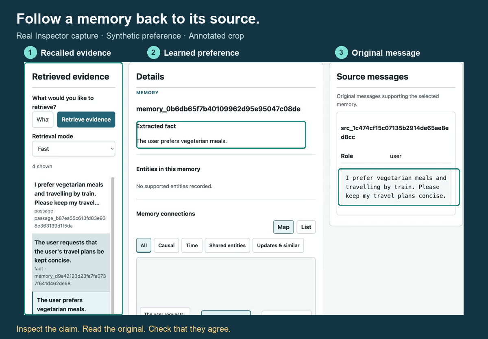

# Open Agent Memory

**让日常 AI Agent 用好记忆。**

[English](README.md) | [中文](README_CN.md) | [日本語](README_JA.md)

[快速开始](#快速开始) · [性能](#性能与准确率) · [接入 Agent](#接入你的-agent) · [文档](docs/indexing-retrieval.md) · [版本发布](https://github.com/rocke2020/open-agent-memory/releases)

Open Agent Memory（OAM）是完全开源的 AI Agent 记忆引擎。它跨会话记住有用的事实、偏好和经历，在 Agent 需要时召回相关证据并附上引用。

将会话和文档保存在你自己的 PostgreSQL 数据库中，自由选择模型服务商，并随时检查 Agent 记住了什么。OAM 提供记忆，Agent 负责组织回答。

## 性能与准确率

**使用低成本 Flash 模型，已记录评分高于对应的 Hindsight 比较结果，LongMemEval S 的已保存上下文减少 73.63%。**

| 基准测试 | OAM | Hindsight 比较结果 | 回答上下文 |
| --- | --- | --- | --- |
| **LongMemEval S**，全部 500 道题 | **95.2%（476/500）** | 94.6%（473/500） | 已保存上下文平均 **11,373.58** tokens，对比 43,124.55；**减少 73.63%** |
| **BEAM-10M**，10 段完整历史中的 200 道题 | **61.56%** 平均量表得分 | 52.16%，基于已保存上下文的回放 | OAM 使用的上下文多 17.43% |

**LME-500：为公平比较，采用与 Hindsight 相同的问题、参考答案，以及逐字节一致的回答和评判提示词模板。** OAM 逐字节复用 Hindsight 已发布 AMB 参考版本的回答与分类评判提示词模板，使回答指令与评判标准保持一致。参见[提示词来源与评测设置](docs/benchmarks.md#1-latest-longmemeval-s-476500-at-18k)。

最新 LongMemEval 结果使用 **MiniMax M3.1 Flash** 回答和评判，上下文上限为 18,000 tokens。早期使用相同上下文的 LongMemEval 运行也记录了 **DeepSeek Flash** 的结果。BEAM-10M 使用 **DeepSeek Flash** 回答和评判；报告保留了各次运行的 high/max 回答设置。这些评测流程使用低成本 Flash 模型，无需昂贵的旗舰回答模型。

比较双方的回答模型、评判模型和记忆流程不同。上下文大小统计的是已保存的格式化文本，而非模型服务商的计费 tokens；当前 LME 平均值来自 497 份上下文，另有 3 道参考答案存在争议的题目仍按错误计入 500 题总分。评测覆盖 L1 记忆，未对洞察、用户画像和文档资源评分。

重新运行回答与评判模型时，评分可能变化。在一个[输入相同的 MiniMax 实例](docs/benchmarks.md#answer-and-judge-variability)中，一次回答正确，另一次回答错误；这展示了已观察到的波动，而非其发生频率。

[结果、模型定价与评测方法](docs/benchmarks.md) · [LME 逐题证据](https://github.com/rocke2020/open-agent-memory-benchmark/tree/main/eval_results/lme500-20261117) · [BEAM 逐题证据](https://github.com/rocke2020/open-agent-memory-benchmark/tree/308eef998091ec05aa2657b637fc37222e029672/eval_results/beam10m)

## 为什么选择 OAM？

- **跨会话记忆。** 保存有用的偏好、决定和经历，让 Agent 在新会话中继续使用。
- **核对原始证据。** 召回的记忆可以追溯到原始消息。在 Memory Inspector 中浏览和删除记忆。
- **一起搜索会话与文档。** 同时召回相关的学习记忆以及文本、HTML、PDF 和图片资源；文档与学习得到的个人记忆保持分离。
- **构建实用的个人画像。** 显式刷新已保存的用户画像，输入来自符合条件的记忆和结构化画像数据。
- **掌控数据与模型。** 使用 PostgreSQL/pgvector 自托管，配置自己的模型端点，并控制召回上下文预算。

## 快速开始

你需要 **Docker 与 Compose**、**Git**、支持文本和图片输入的生成模型端点，以及兼容 OpenAI 的 embedding 端点。OAM 不提供默认模型端点或凭据。模型预检和索引会调用你配置的服务商，可能产生费用。

### 1. 准备配置

```bash
git clone https://github.com/rocke2020/open-agent-memory.git
cd open-agent-memory
cp deploy/.env.example deploy/.env
```

编辑 `deploy/.env`：

- 将 `VLM_BASE_URL`、`VLM_API_KEY`、`VLM_MODEL` 和 `OAM_EMBEDDING_URL`、`OAM_EMBEDDING_KEY`、`OAM_EMBEDDING_MODEL` 设为你的服务商配置。
- 为每个数据库密码和 `OAM_ROOT_API_KEY` 分别设置独立的随机值；每个值都可用 `openssl rand -hex 24` 生成。
- 默认 embedding 维度为 **1024**。如果端点返回其他受支持的维度，请在**初始化前**设置 `deploy/oam.yaml` 中的 `index.embedding_dimensions`。参见[模型配置](docs/operations.md#1-configuration)。

### 2. 启动 OAM

```bash
docker compose --env-file deploy/.env -f deploy/compose.yaml up -d --wait postgres
docker compose --env-file deploy/.env -f deploy/compose.yaml run migrate
docker compose --env-file deploy/.env -f deploy/compose.yaml exec -T postgres psql -U postgres -d oam -f /bootstrap/runtime-roles.sql
docker compose --env-file deploy/.env -f deploy/compose.yaml run api preflight --json
docker compose --env-file deploy/.env -f deploy/compose.yaml up -d --wait api worker
```

任何命令失败时，请先停止并解决报错，再继续下一步。Compose 文件选用 Linux AMD64 或 ARM64 的 **v0.1.0** 镜像。端口、宿主机上的模型服务、源码构建和副本配置见[部署指南](deploy/README.md)。

### 3. 保存并召回第一条记忆

打开 **Memory Inspector：<http://127.0.0.1:17333/ui/>**。按照[创建个人记忆集合](docs/start-here.md#2-create-your-personal-collection)和[保存并召回一项偏好](docs/start-here.md#3-store-and-recall-a-preference)操作：创建用户密钥、保存一条简单偏好、等待索引完成，再召回带引用的记忆。

第一次成功的标志是：召回了一项偏好，而且引用可以追溯到原始消息。随后接入 Agent，在新会话中请它使用这项偏好。

**[首次记忆完整指南 →](docs/start-here.md)**

## 接入你的 Agent

先启动服务并创建用户密钥。客户端包用于连接 OAM，不会启动服务端。

| Agent 或应用 | 接入方式 |
| --- | --- |
| Claude Code 或 Cursor | [MCP 服务与客户端配置](integrations/mcp/README.md#client-configuration)，需要 Node.js 22+ |
| OpenClaw | [插件安装](integrations/openclaw/README.md#npm-installation)，支持自动召回和符合条件的内容采集 |
| DeepSeek Harness（DSH） | [DSH 插件](integrations/dsh/README.md) |
| 自定义应用 | [可复制的 HTTP 示例](docs/quickstart.md)和 [API 参考](docs/api.md) |

## 查看 Agent 记住了什么



Inspector 可用于浏览已保存的来源、检查召回的记忆和引用、管理资源，以及刷新用户画像。截图使用合成演示数据。[Inspector 指南](docs/memory-web-ui.md)。

## 记忆如何工作

OAM 保留原始会话（**L0**），抽取有来源支撑的事实（**L1**），再根据相关事实构建有证据支持的洞察（**L2**）。显式刷新的用户画像（**L3**）帮助 Agent 提供个性化行为。文本、HTML、PDF 和图片**资源（Resources）**作为独立证据保留，可与学习记忆一起检索。

召回支持 **fast** 和 **normal** 模式，返回带引用的上下文，不生成最终回答。两种模式的默认上下文上限分别为 18,000 和 24,000 tokens。Agent 决定如何使用证据，并负责最终回答和总输入预算。

[记忆与检索设计](docs/indexing-retrieval.md) · [架构](docs/architecture.md) · [配置](configs/README.md)

## v0.1.0

本次发布是上文所述的检索质量里程碑：使用低成本 Flash 模型，取得更高的已记录基准评分，并保持紧凑的 LME 上下文。它改进了来源证据选择和上下文格式，将 normal 上下文默认上限降至 24,000 tokens，并新增需显式启用的 fast 评分和实验性来源正文策略。从 v0.0.3 升级时可复用已有索引，无需新增数据库迁移或重新索引。

验证与发布状态见[版本说明和升级指南](docs/releases/0.1.0.md)。OpenClaw 保持独立版本 0.0.2；MCP 和 DSH 保持 0.0.1。

## 文档与开发

| 目标 | 指南 |
| --- | --- |
| 部署或升级 OAM | [Docker Compose](deploy/README.md) |
| 通过 HTTP 保存与召回 | [快速入门](docs/quickstart.md) · [API 参考](docs/api.md) |
| 配置服务商并运维服务 | [运维](docs/operations.md) |
| 了解已验证的行为与限制 | [验收](docs/acceptance.md) · [版本说明](docs/releases/0.1.0.md) |
| 构建、测试或贡献 | [参与贡献](CONTRIBUTING.md) · [发布流程](docs/releasing.md) |

后续工作包括更顺畅的入门体验、减少索引和回答上下文的 token 用量，以及共享资源所有权。Python SDK、托管服务、数据库高可用和 OIDC/LDAP 支持仍属于未来工作。欢迎在 [Discussions](https://github.com/rocke2020/open-agent-memory/discussions/1) 中分享配置和检索反馈。

## 致谢

OAM 参考了 [Hindsight](https://github.com/vectorize-io/hindsight)、[OpenViking](https://github.com/volcengine/OpenViking)、[Mem0](https://github.com/mem0ai/mem0)、[MemOS](https://github.com/MemTensor/MemOS)、[TencentDB Agent Memory](https://github.com/TencentCloud/TencentDB-Agent-Memory) 和 [gbrain](https://github.com/garrytan/gbrain) 的开源工作。感谢 [LongMemEval](https://github.com/xiaowu0162/LongMemEval) 和 [BEAM](https://github.com/mohammadtavakoli78/BEAM) 的作者与贡献者。详见[完整致谢](ACKNOWLEDGMENTS.md)和[第三方声明](THIRD_PARTY.md)。

## 许可证

[Apache License 2.0](LICENSE)。
