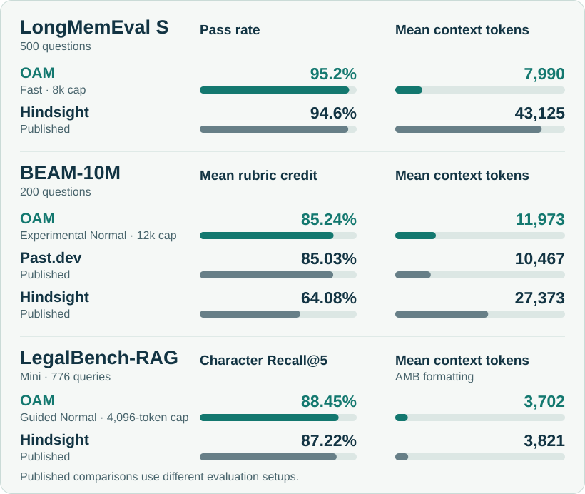

# Open Agent Memory

**让日常 AI Agent 用好记忆。**

[English](README.md) | [简体中文](README_CN.md) | [日本語](README_JA.md)

[快速开始](#快速开始) · [性能](#性能与准确率) · [接入 Agent](#接入你的-agent) · [文档](docs/zh/README.md) · [版本发布](https://github.com/rocke2020/open-agent-memory/releases)

Open Agent Memory（OAM）是完全开源的 AI Agent 记忆引擎。它跨会话记住有用的事实、偏好和经历，在 Agent 需要时召回相关证据并附上引用。

将会话和文档保存在你自己的 PostgreSQL 数据库中，自由选择模型服务商，并随时检查 Agent 记住了什么。OAM 提供记忆，Agent 负责组织回答。

## 性能与准确率



**LongMemEval S（LME-500）：在 8,000 tokens 上限下获得 476/500（95.2%）。** OAM 的 Fast 全文搜索（FTS）与 BM25 评测平均使用 **7,990** tokens 的已保存上下文，Hindsight 公布的 **473/500（94.6%）** 对应 **43,125** tokens。OAM 的 18k Normal FTS 评测得分为 **478/500（95.6%）**。8k 评测通过适配器复用已有 L1 索引，平均上下文比 18k 评测**少 29.8%**。[LME-500 方法及结果](docs/zh/benchmarks.md#1-longmemeval-s-的-8k-与-18k-结果)

**BEAM-10M：召回上下文上限为 12,000 tokens，平均评分 85.24%，通过 179/200 题。** 11 月 27 日的评测覆盖十段千万 token 规模会话的全部 200 道题，使用 OAM Normal 召回，并在评测程序中加入实验性的原文恢复步骤。[BEAM-10M 方法及结果](docs/zh/benchmarks.md#3-beam-10m)

OAM 超过了 Past.dev 在其公开 BEAM-10M 对照表中列出的最高分 **85.03%**，也比 Hindsight 公布的 **64.08%** 高 **21.16 个百分点**，多通过 **32 道题**。OAM 的召回上下文平均为 **11,973** tokens，Hindsight 为 **27,373**，减少 **56.26%**。这些端到端评测采用了不同的评估配置。[Past.dev 成绩表](https://past.dev/benchmarks/beam) · [Hindsight 对比](docs/zh/benchmarks.md#3-beam-10m)

**与 Past.dev 的配对重放**采用同样的 12,000 tokens 上限、提示词和 MiniMax M3.1 Flash adaptive 回答与评判配置。OAM 为 **85.49%（通过 180/200 题）**，Past.dev 已保存的召回结果为 **80.54%（通过 172/200 题）**。OAM 高 **4.95 个百分点**，双方平均上下文分别为 **11,973** 和 **10,142** tokens。[配对重放详情](docs/zh/benchmarks.md#beam-10m-matched-replay)

重新运行回答与评判模型时，评分可能变化。在一个[输入相同的 MiniMax 实例](docs/zh/benchmarks.md#回答和评判的波动)中，一次回答正确，另一次回答错误；这展示了已观察到的波动，而非其发生频率。

**LegalBench-RAG mini 文档检索的字符级 Recall@5 为 88.45%，Hindsight 公布的结果为 87.22%。** 评测覆盖全部 **776 条查询**和 **714 份文档**，按前五条结果平均召回的标注证据字符比例计分。按 Agent Memory Benchmark 的格式统计，OAM 和 Hindsight 的平均上下文分别为 **3,702** 和 **3,821** tokens。OAM 使用文档引导的 Normal 召回，原生上下文上限为 **4,096 tokens**。[LegalBench-RAG mini 方法及结果](docs/zh/benchmarks.md#legalbench-rag-mini)

[评测结果与方法](docs/zh/benchmarks.md) · [OAMB 评测结果索引](https://github.com/rocke2020/open-agent-memory-benchmark/blob/main/eval_results/README.md)

## 为什么选择 OAM？

- **跨会话记忆。** 保存有用的偏好、决定和经历，让 Agent 在新会话中继续使用。
- **核对原始证据。** 召回的记忆可以追溯到原始消息。在 Memory Inspector 中浏览和删除记忆。
- **一起搜索会话与文档。** 同时召回相关的学习记忆以及文本、HTML、PDF 和图片资源；文档与学习得到的个人记忆保持分离。
- **构建实用的个人画像。** 手动或定时刷新已保存的用户画像，也可为特定用途按需生成自定义画像。
- **掌控数据与模型。** 使用 PostgreSQL/pgvector 自托管，配置自己的模型端点，并控制召回上下文预算。

## 快速开始

你需要 **Docker 与 Compose**、**Git**、支持文本和图片输入的生成模型端点，以及兼容 OpenAI 的 embedding 端点。OAM 不提供默认模型端点或凭据。模型预检和索引会调用你配置的服务商，可能产生费用。

### 1. 准备配置

```bash
git clone https://github.com/rocke2020/open-agent-memory.git
cd open-agent-memory
cp deploy/.env.example deploy/.env
```

编辑 `deploy/.env`：

- 将 `VLM_BASE_URL`、`VLM_API_KEY`、`VLM_MODEL` 和 `OAM_EMBEDDING_URL`、`OAM_EMBEDDING_KEY`、`OAM_EMBEDDING_MODEL` 设为你的服务商配置。
- 为每个数据库密码和 `OAM_ROOT_API_KEY` 分别设置独立的随机值；每个值都可用 `openssl rand -hex 24` 生成。
- 默认 embedding 维度为 **1024**。如果端点返回其他受支持的维度，请在**初始化前**设置 `deploy/oam.yaml` 中的 `index.embedding_dimensions`。参见[模型配置](docs/zh/operations.md#1-配置)。

### 2. 启动 OAM

```bash
docker compose --env-file deploy/.env -f deploy/compose.yaml up -d --wait postgres
docker compose --env-file deploy/.env -f deploy/compose.yaml run migrate
docker compose --env-file deploy/.env -f deploy/compose.yaml exec -T postgres psql -U postgres -d oam -f /bootstrap/runtime-roles.sql
docker compose --env-file deploy/.env -f deploy/compose.yaml run api preflight --json
docker compose --env-file deploy/.env -f deploy/compose.yaml up -d --wait api worker
```

任何命令失败时，请先停止并解决报错，再继续下一步。Compose 文件选用 Linux AMD64 或 ARM64 的 **v0.2.1** 镜像。端口、宿主机上的模型服务、源码构建和副本配置见[部署指南](deploy/README_CN.md)。

### 3. 保存并召回第一条记忆

打开 **Memory Inspector：<http://127.0.0.1:17333/ui/>**。按照[创建个人记忆集合](docs/zh/start-here.md#2-创建个人记忆集合)和[保存并召回一项偏好](docs/zh/start-here.md#3-保存并召回一项偏好)操作：创建用户密钥、保存一条简单偏好、等待索引完成，再召回带引用的记忆。

第一次成功的标志是：召回了一项偏好，而且引用可以追溯到原始消息。随后接入 Agent，在新会话中请它使用这项偏好。

**[首次记忆完整指南 →](docs/zh/start-here.md)**

## 接入你的 Agent

先启动服务并创建用户密钥。客户端包用于连接 OAM，不会启动服务端。

| Agent 或应用 | 接入方式 |
| --- | --- |
| Claude Code 或 Cursor | [MCP 服务与客户端配置](integrations/mcp/README_CN.md#通过发布归档安装)，需要 Node.js 22+ |
| OpenClaw | [插件安装](integrations/openclaw/README_CN.md#通过发布归档安装)，支持自动召回和符合条件的内容采集 |
| DeepSeek Harness（DSH） | [DSH 插件](integrations/dsh/README_CN.md#通过发布归档安装) |
| 自定义应用 | [可复制的 HTTP 示例](docs/zh/quickstart.md)和 [API 参考](docs/zh/api.md) |

## 查看 Agent 记住了什么


Inspector 可用于浏览已保存的来源、检查召回的记忆和引用、管理资源，以及刷新用户画像。截图使用合成演示数据。[Inspector 指南](docs/zh/memory-web-ui.md)。

## 记忆如何工作

OAM 保留原始会话（**L0**），抽取有来源支撑的事实（**L1**），再根据相关事实构建有证据支持的洞察（**L2**）。可刷新的持久化用户画像（**L3**）帮助 Agent 提供个性化行为。文本、HTML、PDF 和图片**资源（Resources）**作为独立证据保留，可与学习记忆一起检索。

召回默认使用 **Fast**，并将带引用的上下文返回给 Agent。Fast、Normal 和 Deep 的默认上下文上限分别为 **8,000**、**16,000** 和 **24,000** tokens。可在 YAML 中将 `search.default_recall_level` 设为 `fast`、`normal` 或 `deep`，用于未指定 `recall_level` 的 API 请求。显式指定的模式优先。

[记忆与检索设计](docs/zh/indexing-retrieval.md) · [架构](docs/zh/architecture.md) · [配置](configs/README_CN.md)

## v0.2.1

v0.2.1 增加可配置的 Fast 默认模式、三档召回预设以及原生 BM25 排序。英文和简体中文文档涵盖相同的部署、接入与运维流程。

升级、验证范围和下载见[版本说明（英文）](docs/releases/0.2.1.md)。Agent 接入包采用独立版本号。

## 文档与开发

浏览[简体中文文档](docs/zh/README.md)或[英文文档](docs/README.md)。

| 目标 | 指南 |
| --- | --- |
| 部署或升级 OAM | [Docker Compose](deploy/README_CN.md) |
| 通过 HTTP 保存与召回 | [快速入门](docs/zh/quickstart.md) · [API 参考](docs/zh/api.md) |
| 配置服务商并运维服务 | [运维](docs/zh/operations.md) |
| 了解已验证的行为与限制 | [验收](docs/zh/acceptance.md) · [版本说明（英文）](docs/releases/0.2.1.md) |
| 构建、测试或贡献 | [参与贡献（英文）](CONTRIBUTING.md) · [发布流程](docs/zh/releasing.md) |

后续工作包括更顺畅的入门体验、减少索引和回答上下文的 token 用量，以及共享资源所有权。Python SDK、托管服务、数据库高可用和 OIDC/LDAP 支持仍属于未来工作。欢迎在 [Discussions](https://github.com/rocke2020/open-agent-memory/discussions/1) 中分享配置和检索反馈。

## 致谢

OAM 参考了 [Hindsight](https://github.com/vectorize-io/hindsight)、[OpenViking](https://github.com/volcengine/OpenViking)、[Mem0](https://github.com/mem0ai/mem0)、[MemOS](https://github.com/MemTensor/MemOS)、[TencentDB Agent Memory](https://github.com/TencentCloud/TencentDB-Agent-Memory) 和 [gbrain](https://github.com/garrytan/gbrain) 的开源工作。感谢 [LongMemEval](https://github.com/xiaowu0162/LongMemEval) 和 [BEAM](https://github.com/mohammadtavakoli78/BEAM) 的作者与贡献者。详见[完整致谢](ACKNOWLEDGMENTS.md)和[第三方声明](THIRD_PARTY.md)。

## 许可证

[Apache License 2.0](LICENSE)。
