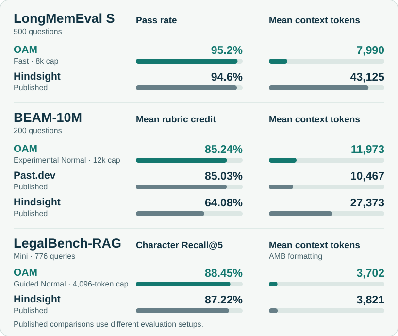
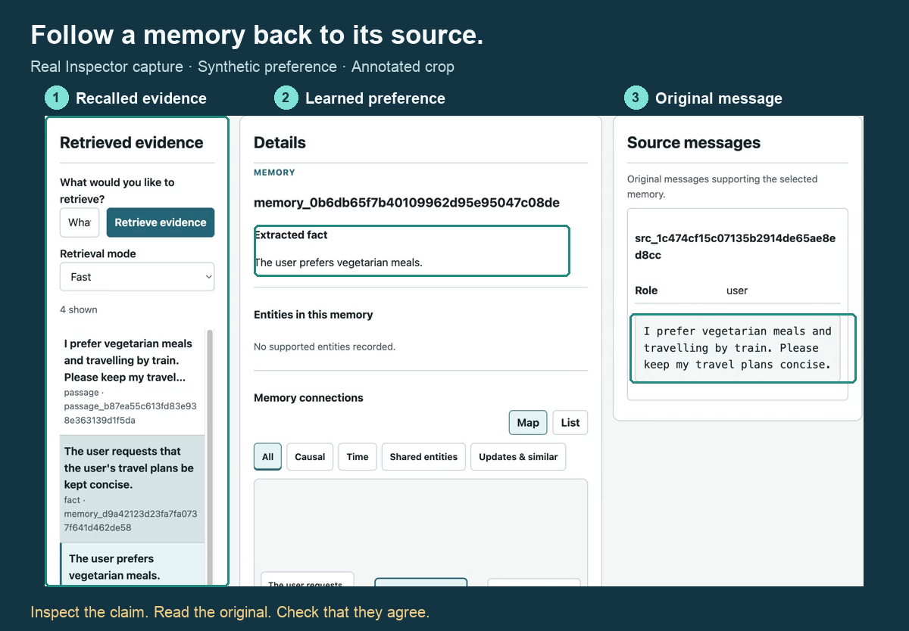

# Open Agent Memory

**日常の AI エージェントに、役立つメモリを。**

[English](README.md) | [简体中文](README_CN.md) | [日本語](README_JA.md)

[はじめに](#はじめに) · [性能](#パフォーマンスと精度) · [エージェント連携](#エージェントを接続する) · [ドキュメント（英語）](docs/README.md) · [リリース](https://github.com/rocke2020/open-agent-memory/releases)

Open Agent Memory（OAM）は、AI エージェント向けの完全にオープンソースのメモリエンジンです。会話をまたいで有用な事実、好み、経験を記憶し、エージェントが必要とするときに、関連する証拠を出典付きで取り出します。

会話と文書を自分の PostgreSQL データベースに保存し、モデルプロバイダーを選び、エージェントが何を記憶しているか確認できます。OAM がメモリを提供し、エージェントが回答を作成します。

## パフォーマンスと精度



**LongMemEval S（LME-500）では、上限 8,000 トークンで 476/500 問（95.2%）に正答しました。** OAM の Fast 全文検索（FTS）と BM25 の評価で保存済みコンテキストは平均 **7,990** トークン、Hindsight の公開結果 **473/500（94.6%）** では **43,125** トークンでした。OAM の 18k Normal FTS 評価は **478/500（95.6%）** でした。8k の評価はアダプター経由で既存の L1 インデックスを再利用し、平均コンテキストは 18k の評価より **29.8% 少なく**なりました。[LME-500 の評価方法と結果](docs/benchmarks.md#1-longmemeval-s-at-8k-and-18k)

**BEAM-10M で、検索コンテキストの上限 12,000 トークンで平均スコア 85.24%、179/200 問が合格しました。** 11 月 27 日の評価は、1,000 万トークン規模の会話 10 件にわたる全 200 問を対象としています。OAM の Normal 検索を使用し、評価プログラムに原文を補う実験的な処理を加えました。[BEAM-10M の評価方法と結果](docs/benchmarks.md#3-beam-10m)

OAM は、Past.dev の公開比較表で最高の **85.03%** を上回り、Hindsight の公開スコア **64.08%** より **21.16 ポイント高く、合格数も 32 問多く**なりました。検索コンテキストの平均は OAM が **11,973** トークン、Hindsight が **27,373** トークンで、OAM は **56.26% 少ない**結果でした。各システムの評価条件は異なります。[Past.dev の比較表](https://past.dev/benchmarks/beam) · [Hindsight との比較](docs/benchmarks.md#3-beam-10m)

**Past.dev との同条件での再評価**では、双方に同じ 12,000 トークンの上限とプロンプトを適用し、MiniMax M3.1 Flash の adaptive モードで回答と判定を行いました。OAM は **85.49%（180/200 問合格）**、Past.dev の保存済み検索結果は **80.54%（172/200 問合格）** で、OAM が **4.95 ポイント**上回りました。平均コンテキストはそれぞれ **11,973** トークンと **10,142** トークンでした。[再評価の詳細](docs/benchmarks.md#beam-10m-matched-replay)

回答・判定モデルを再実行すると、スコアが変わることがあります。[同じ入力を使った MiniMax の実例](docs/benchmarks.md#answer-and-judge-variability)では、一方の回答は正解、もう一方は不正解でした。これは観測された変動の例であり、その発生頻度を示すものではありません。

**LegalBench-RAG mini の文書検索で、OAM の文字単位 Recall@5 は 88.45%、Hindsight の公開結果は 87.22% でした。** 全 **776 クエリ**と **714 文書**を対象に、上位 5 件で取得できた正解根拠の文字の割合を平均しました。Agent Memory Benchmark の形式で計測した平均コンテキストは、OAM が **3,702** トークン、Hindsight が **3,821** トークンでした。OAM は文書単位の候補選定を組み込んだ Normal 検索を使い、コンテキスト上限は **4,096 トークン**でした。[LegalBench-RAG mini の評価方法と結果](docs/benchmarks.md#legalbench-rag-mini)

[評価結果と方法](docs/benchmarks.md) · [OAMB の評価結果一覧](https://github.com/rocke2020/open-agent-memory-benchmark/blob/main/eval_results/README.md)

## OAM を選ぶ理由

- **セッションをまたいで記憶。** 役立つ好み、決定、経験を保存し、新しい会話でもエージェントが利用できます。
- **証拠を確認。** 検索したメモリから元のメッセージを辿れます。Memory Inspector でメモリの閲覧や削除ができます。
- **会話と文書をまとめて検索。** 学習メモリとともに、関連するテキスト、HTML、PDF、画像の Resources を検索できます。文書は学習された個人メモリとは分けて保持します。
- **役立つ個人プロフィールを作成。** 保存済みの User Profile を手動または定期的に更新し、用途に応じたカスタム Profile をオンデマンドで生成できます。
- **データとモデルを自分で管理。** PostgreSQL/pgvector でセルフホストし、独自のエンドポイントを設定し、検索コンテキストの予算を制御できます。

## はじめに

**Docker と Compose**、**Git**、テキストと画像の入力をサポートする生成モデルのエンドポイント、OpenAI 互換の embedding エンドポイントが必要です。OAM は既定のモデルエンドポイントや認証情報を提供しません。モデルの事前チェックとインデックス作成では、設定したプロバイダーを呼び出すため、料金が発生する場合があります。

### 1. 設定を準備する

```bash
git clone https://github.com/rocke2020/open-agent-memory.git
cd open-agent-memory
cp deploy/.env.example deploy/.env
```

`deploy/.env` を編集します。

- `VLM_BASE_URL`、`VLM_API_KEY`、`VLM_MODEL` と `OAM_EMBEDDING_URL`、`OAM_EMBEDDING_KEY`、`OAM_EMBEDDING_MODEL` にプロバイダーの設定を指定します。
- 各データベースのパスワードと `OAM_ROOT_API_KEY` に、それぞれ異なるランダムな値を設定します。各値は `openssl rand -hex 24` で生成できます。
- embedding の既定の次元数は **1024** です。エンドポイントが別のサポート対象の次元数を返す場合は、**初期化前に** `deploy/oam.yaml` の `index.embedding_dimensions` を設定してください。[モデル設定](docs/operations.md#1-configuration)を参照してください。

### 2. OAM を起動する

```bash
docker compose --env-file deploy/.env -f deploy/compose.yaml up -d --wait postgres
docker compose --env-file deploy/.env -f deploy/compose.yaml run migrate
docker compose --env-file deploy/.env -f deploy/compose.yaml exec -T postgres psql -U postgres -d oam -f /bootstrap/runtime-roles.sql
docker compose --env-file deploy/.env -f deploy/compose.yaml run api preflight --json
docker compose --env-file deploy/.env -f deploy/compose.yaml up -d --wait api worker
```

コマンドが失敗した場合は、そこで止めてエラーを解決してから続けてください。Compose ファイルは Linux AMD64 または ARM64 向けの **v0.2.1** イメージを選択します。ポート、ホスト上のモデルサーバー、ソースからのビルド、レプリカ構成は[デプロイガイド](deploy/README.md)を参照してください。

### 3. 最初のメモリを保存して検索する

**Memory Inspector：<http://127.0.0.1:17333/ui/>** を開きます。[個人コレクションの作成](docs/start-here.md#2-create-your-personal-collection)、[好みの保存と検索](docs/start-here.md#3-store-and-recall-a-preference)の順に進めてください。ユーザーキーを作成し、簡単な好みを保存し、インデックス作成を待ってから、出典付きで取り出します。

最初の成功の目印は、検索した好みの出典から元のメッセージを確認できることです。その後でエージェントを接続し、新しいセッションでその好みを使うよう依頼してください。

**[最初のメモリまでの完全ガイド →](docs/start-here.md)**

## エージェントを接続する

先にサービスを起動し、ユーザーキーを作成してください。クライアントパッケージは OAM に接続するもので、サーバーを起動するものではありません。

| エージェント・アプリケーション | 接続方法 |
| --- | --- |
| Claude Code または Cursor | [MCP サーバーとクライアント設定](integrations/mcp/README.md#release-archive-installation)、Node.js 22+ |
| OpenClaw | [プラグインのインストール](integrations/openclaw/README.md#release-archive-installation)、自動検索と対象コンテンツの自動保存に対応 |
| DeepSeek Harness（DSH） | [DSH プラグイン](integrations/dsh/README.md#release-archive-installation) |
| 独自アプリケーション | [コピーして使える HTTP の例](docs/quickstart.md)と [API リファレンス](docs/api.md) |

## エージェントの記憶を確認する



Inspector では、保存した出典の閲覧、検索したメモリと出典の確認、Resources の管理、User Profile の更新ができます。このスクリーンショットは合成デモデータを使用しています。[Inspector ガイド](docs/memory-web-ui.md)。

## メモリの仕組み

OAM は元の会話（**L0**）を保持し、出典に裏付けられた事実（**L1**）を抽出し、関連する事実から根拠のある Insights（**L2**）を作成します。更新可能な保存済みの User Profile（**L3**）は、エージェントの振る舞いの個人化に役立ちます。テキスト、HTML、PDF、画像の **Resources** は独立した証拠として保持し、学習メモリとともに検索できます。

検索の既定モードは **Fast** で、エージェントが使う出典付きコンテキストを返します。Fast、Normal、Deep の既定上限はそれぞれ **8,000**、**16,000**、**24,000** トークンです。API リクエストで `recall_level` が省略された場合のモードは、YAML の `search.default_recall_level` に `fast`、`normal`、`deep` のいずれかを指定して変更できます。リクエストで明示したモードが優先されます。

[メモリと検索の設計](docs/indexing-retrieval.md) · [アーキテクチャ](docs/architecture.md) · [設定](configs/README.md)

## v0.2.1

v0.2.1 では、設定可能な Fast の既定モード、3 種類の検索プリセット、ネイティブの BM25 順位付けが利用できます。英語と簡体字中国語のドキュメントに、導入、連携、運用の手順を掲載しています。

アップグレード手順、検証範囲、ダウンロードについては[リリースノート](docs/releases/0.2.1.md)を参照してください。エージェント連携パッケージは独立したバージョンを持ちます。

## ドキュメントと開発

| 目的 | ガイド |
| --- | --- |
| OAM のデプロイ・アップグレード | [Docker Compose](deploy/README.md) |
| HTTP での保存と検索 | [クイックスタート](docs/quickstart.md) · [API リファレンス](docs/api.md) |
| プロバイダー設定とサービス運用 | [運用](docs/operations.md) |
| 検証済みの動作と制約の確認 | [受け入れ要件](docs/acceptance.md) · [リリースノート](docs/releases/0.2.1.md) |
| ビルド・テスト・開発への参加 | [貢献ガイド](CONTRIBUTING.md) · [リリース手順](docs/releasing.md) |

今後は、導入体験の改善、インデックス作成と回答コンテキストのトークン削減、Resources の共有所有権に取り組む予定です。Python SDK、ホスティングサービス、データベースの高可用性、OIDC/LDAP 対応は今後の対象です。設定や検索に関するフィードバックは [Discussions](https://github.com/rocke2020/open-agent-memory/discussions/1) で共有してください。

## 謝辞

OAM は、[Hindsight](https://github.com/vectorize-io/hindsight)、[OpenViking](https://github.com/volcengine/OpenViking)、[Mem0](https://github.com/mem0ai/mem0)、[MemOS](https://github.com/MemTensor/MemOS)、[TencentDB Agent Memory](https://github.com/TencentCloud/TencentDB-Agent-Memory)、[gbrain](https://github.com/garrytan/gbrain) のオープンソースの取り組みを参考にしています。[LongMemEval](https://github.com/xiaowu0162/LongMemEval) と [BEAM](https://github.com/mohammadtavakoli78/BEAM) の著者および貢献者の皆様にも感謝します。[謝辞の全文](ACKNOWLEDGMENTS.md)と[サードパーティに関する表示](THIRD_PARTY.md)を参照してください。

## ライセンス

[Apache License 2.0](LICENSE)。
