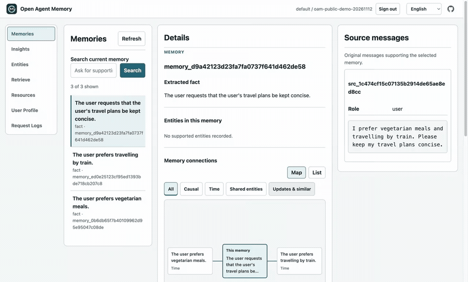

# Open Agent Memory

[English（正本）](README.md) | [简体中文](README_CN.md) | 日本語

Open Agent Memory（OAM）は、AI エージェント向けの完全にオープンソースのメモリエンジンです。学習対象として認められた会話から、出典に裏付けられた事実と Insights を作成し、文書は独立した Resources として保持して、両方を出典付きで検索します。明示的に更新する User Profile により、エージェントはセッションをまたいで有用な個人のコンテキストを引き継げます。

## パフォーマンスと精度

評価コストを抑え、日常的なエージェントの作業に使うモデルでメモリの性能を示すため、**DeepSeek Flash** を選びました。完了した v0.0.1 開発評価では、**初回回答は high の推論強度とし、条件を満たす場合に限り max の推論強度で最大 1 回再試行**し、採点にも high の推論強度を使用しました。対象は **LongMemEval S の 500 問**と **BEAM-10M の 200 問**です。

### 記録された DeepSeek ベースの結果

| 評価 | OAM | DeepSeek を使用した Hindsight | 観測された差 |
|---|---|---|---|
| [LME-500：回答の正答率](https://github.com/rocke2020/open-agent-memory-benchmark/tree/32bf1921f0db7c8f0008428b06b637c1f93ff385/eval_results/lme500) | **94% (470/500)** | 89.6% (448/500) | **+4.4 パーセントポイント** |
| [BEAM-10M：ルーブリックの平均スコア](https://github.com/rocke2020/open-agent-memory-benchmark/tree/32bf1921f0db7c8f0008428b06b637c1f93ff385/eval_results/beam10m) | **61.56%** | 52.16%（保存済みコンテキストの再生） | **+9.40 パーセントポイント** |

**LME の比較：** OAM は DeepSeek Flash と上記の初回 high／再試行 max のポリシーを使用しました。[Hindsight の完全な再現評価](https://github.com/rocke2020/agent-memory-benchmark/tree/b6eac3dbd41de03fb6ac31486b342f4d1b556dde)では、抽出と採点に DeepSeek V4 Flash 0731、回答に V4 Pro 0813 を使用しました。モデルのバージョンと回答生成の設定は異なります。

**BEAM の比較：** 両方の評価群で、同じ 200 問に対して同じ DeepSeek Flash の回答・採点ポリシーを使用しました。Hindsight は保存済みコンテキストを再生し、エンジンは再実行していません。OAM が回答に使用したコンテキストは 17.43% 多くなりました。[比較方法と設問ごとの検証記録](https://github.com/rocke2020/open-agent-memory-benchmark/blob/32bf1921f0db7c8f0008428b06b637c1f93ff385/eval_results/beam10m/README.md)を参照してください。

LME-500 は fast 検索を使用し、**回答コンテキストは平均 12.4K トークン**でした。BEAM-10M では、**切り詰めていない完全な会話履歴 10 件**を、履歴ごとに 20 問で評価しました。リンク先のレポートには、各実行で使用したモデルのバインディングが記録されています。

これらの過去の開発評価では、L1 メモリを使った検索、回答、採点を測定しました。L2 Insights、User Profile、文書 Resources は採点の対象外です。

評価方法、モデル設定、コンテキストの計数値、評価対象のリビジョン、制約、全設問の保存済み検証記録については、[ベンチマーク結果と再現方法](docs/benchmarks.md)を参照してください。

[出典付き検索を初めて実行する](docs/quickstart.md) · [MCP の設定](integrations/mcp/README.md) · [ベンチマーク結果と再現方法](docs/benchmarks.md)

[](https://github.com/rocke2020/open-agent-memory/releases/download/v0.0.1/oam-v0.0.1-cited-recall-demo.mp4)

[71 秒のデモを見る](https://github.com/rocke2020/open-agent-memory/releases/download/v0.0.1/oam-v0.0.1-cited-recall-demo.mp4)：既存の合成メモリを使い、新しく起動した MCP プロセスから準備状態を確認して検索し、続いて Memory Inspector で元の出典を表示します。録画は 2× 速で、完成済みのインデックスを再利用しています。

Node.js 22+ を使って、既存の OAM デプロイを MCP クライアントに接続します。

```json
{
  "mcpServers": {
    "oam": {
      "command": "npx",
      "args": ["-y", "@rocke-dong/oam-mcp@0.0.1"],
      "env": {
        "OAM_BASE_URL": "http://127.0.0.1:17333",
        "OAM_USER_ID": "your-user-id",
        "OAM_USER_API_KEY": "your-user-key"
      }
    }
  }
}
```

自分のユーザースコープのキーを使い、クライアント設定は非公開にしてください。[先に OAM を設定](deploy/README.md)してから、[Claude Code と Cursor の手順](integrations/mcp/README.md#client-configuration)に従ってください。

## Open Agent Memory とは

「Open」はメモリシステム全体を意味します。インデックス作成、検索、Profile、ユーザーによる制御、ネイティブなマルチノード運用を、開発者が確認、実行、変更、改善できます。

HTTP API、ローカルの [MCP サーバー](integrations/mcp/README.md)、または OpenClaw と DeepSeek Harness のプラグインで接続できます。同梱の Memory Inspector では、メモリの閲覧、出典の確認、Resources の検索、保持する内容の管理ができます。

## Open Agent Memory を選ぶ理由

- **システム全体をオープンソースで提供し、マルチノード展開をネイティブにサポート。** 共有 PostgreSQL/pgvector を使い、ステートレスな API レプリカと永続的な処理を担うワーカーを複数ノードで実行できます。協調制御、復旧、デプロイのコードも含まれます。
- **根拠付きのメモリ検索。** 事実や Insights と、それを裏付ける原文の抜粋や引用をまとめて取得し、エージェントが出典に基づいて推論できるようにします。
- **会話と文書をまとめて検索。** HTML、PDF、画像の Resources は、学習による個人メモリと分離したまま、共通の検索経路で取得できます。
- **必要なときにパーソナライズ。** 適格なメモリと明示的に提供された Profile Data から、要求に応じて User Profile を作成・保存します。入力が変わらなければ生成せずに再利用します。
- **メモリの確認と制御。** Inspector で出典を閲覧し、個別の Memory Unit や Insight を削除できます。文書 Resources も、同じ認可済み API で管理できます。
- **データとモデルを自分で管理。** メモリを PostgreSQL/pgvector 上にセルフホストし、利用するモデルのエンドポイントを設定できます。

検証済みの動作、デプロイの制約、配布物については、[受け入れ要件](docs/acceptance.md)、[リリースの検証記録](docs/release-evidence.md)、[公開リリース](https://github.com/rocke2020/open-agent-memory/releases/tag/v0.0.1)を参照してください。

## はじめに

リポジトリをクローンし、Linux AMD64 または ARM64 向けの公開済み v0.0.1 イメージを取得します。

```bash
git clone https://github.com/rocke2020/open-agent-memory.git
cd open-agent-memory
docker pull ghcr.io/rocke2020/open-agent-memory:0.0.1
```

[Docker Compose ガイド](deploy/README.md)に従って PostgreSQL とモデルのエンドポイントを設定し、OAM を初期化して Memory Inspector を開きます。公開イメージを使うには、`OAM_IMAGE=ghcr.io/rocke2020/open-agent-memory:0.0.1` を `deploy/.env` に設定してください。

[HTTP API](docs/api.md)、[MCP サーバー](integrations/mcp/README.md)、または [OpenClaw](integrations/openclaw/README.md#npm-installation) か [DeepSeek Harness](integrations/dsh/README.md) のプラグインで接続できます。[コピーして実行できる保存 → 準備完了の確認 → 検索の例](docs/quickstart.md)から始めて、会話を保存し、インデックス作成を待ち、返された出典を確認してください。

## プロダクトモデル

- **L0 出典となる証拠：** 役割、時刻、出典の識別情報、学習対象かどうかを含む、適格な会話の保存データ。
- **L1 学習メモリ：** 適格なやり取りから抽出した、出典に紐づく事実、好み、経験、イベント、制約。
- **L2 Insights：** 関連する適格な L1 レコードを統合して保存したものです。根拠の連鎖を通じて L0 に遡れます。説明用のサブタイプとして `preferences`、`patterns`、`projects`、`relationships`、`experiences`、`general_insights` のいずれかを持ちますが、サブタイプは順位付けに影響しません。
- **L3 User Profile：** Profile Data と適格な学習メモリから作成する、明示的に更新される読み取り専用の単一文書です。入力が変わらなければ、生成モデルを呼び出さずに再利用します。
- **Profile Data：** 明示的に提供された構造化された基本情報や好みです。User Profile の正確な入力値に対応付けられ、通常の検索には含まれません。
- **Resources：** 保存されたテキスト、HTML、PDF、画像の原本と、詳細な抜粋、位置情報、要約です。検索可能な証拠として保持され、自動的に L1–L3 へ取り込まれることはありません。

`api_key` モードでは、認証情報から決まるテナントと、ユーザーキーに紐づく `user_id` によって個人メモリのコレクションを識別します。管理者は `POST /v1/users` でユーザーを作成し、そのユーザーの最初のキーを一度だけ受け取ります。ホストアプリケーションはユーザーキーを使い、`POST /v1/retain` でやり取りを保存し、`POST /v1/users/{user_id}/resources` で文書の原本を保存し、`POST /v1/users/{user_id}/profile-data` で構造化されたユーザー入力を保存し、`POST /v1/recall` で検索します。管理者キーは個人の内容を直接読み書きできません。ローカルの `dev` モードはキーなしのリクエストを受け付け、プライバシー保護を保証しません。`trusted` モードはゲートウェイが表明するテナントとユーザーのヘッダーを使用し、ローカル以外からのリクエストにはルートキーが必要です。やり取りの保存では、呼び出し側による出典 ID やメッセージ ID の管理は不要です。文書には安定した `document_id` を使い、`replace` またはテキスト専用の `append` を明示します。リビジョンは OAM が割り当てます。[HTTP API](docs/api.md)では、モード選択、JSON と multipart の例、ユーザーキーのローテーション、再試行キー、処理の準備状態を説明しています。

検索では、レンダリング後のコンテキスト全体に対して、`search.fast.context_max_tokens: 18000` と `search.normal.context_max_tokens: 32768` の単一上限を適用します。既定では原文のチャンクを含めます。`include.chunks: false` にすると、適格な学習テキスト、必要な根拠となる事実、引用を残しつつ、原文の全文を省略します。学習された証拠と原文は関連性に従って採用され、事実が抽出されなかった原文も対象になります。証拠のグループは切り詰めずに全体が収まる必要があり、共有される出典チャンクは一度だけ数えます。適格な L1 の事実が 1 件のみで、その完全な根拠と合わせて上限を超える場合は、より上位の主結果をまだ採用していないときに限り、そのグループだけを返して追加を終了し、超過量を報告します。Insights にこの例外はありません。`context_tokens` はローカルの `o200k_base` トークナイザーで引用とメタデータを含む返却テキスト全体を数えます。プロバイダーの使用量ではありません。ホストは最終的に組み立てたモデル入力を別途計測します。

## アーキテクチャ

OAM は Python、FastAPI、psycopg を使った明示的な SQL、pgvector を備えた PostgreSQL を使用します。API プロセスはステートレスです。受理した原本、認可、出典のライフサイクル、操作、ワーカーのタスク取得、リース、フェンシングトークン、アプリケーションレプリカの復旧は PostgreSQL が担います。各サービスは OpenAI Chat、OpenAI Responses、Anthropic Messages のいずれかを通じて、設定された 1 つの VLM を使用します。役割ごとの推論強度に加え、独立した embedding モデルと任意の reranker モデルを設定できます。既定のプロバイダー、モデル、エンドポイント、認証情報はありません。

```text
trusted application -> user-authorized retain -> PostgreSQL receipt + immutable original
                                      |
                                      v
                               durable workers
                         interactions -> L0 -> L1 -> L2
                         Resources -> passages + abstract
                                      |
                                      v
                         joint fast/normal recall + citations

explicit User Profile refresh -> unchanged: zero calls
                         -> changed: durable operation -> L3
```

[アーキテクチャ](docs/architecture.md)、[HTTP API](docs/api.md)、[設定ガイド](configs/README.md)、[運用](docs/operations.md)、[Memory Web UI ガイド](docs/memory-web-ui.md)、[受け入れ要件](docs/acceptance.md)、現在の[手順 1–4 の基盤検証記録](docs/foundation-evidence.md)を参照してください。

## 開発環境

Python 3.12–3.14 と `uv` が必要です。

```bash
uv sync --locked
uv run pytest -q
uv run ruff check .
uv run ruff format --check .
uv run oam preflight --config configs/oam.yaml --json
```

正本となる設定では、共通の `models.vlm` と独立した `models.embedding` を定義します。生成プロトコルには `openai_chat`、`openai_responses`、`anthropic_messages` のいずれかを選び、モデル、エンドポイント、認証情報を非公開の環境変数で設定します。`models.reasoning_effort` は `none`、`low`、`high`、`max` によって各役割を有効化します。YAML の null はその役割を無効化します。VLM の推論モードによって、実際に送信する設定が決まります。Preflight は選択したプロトコルを使って、有効なテキストと画像の役割を検証します。実際のモデル機能はエンドポイントに依存します。プロトコルのパスと推論オプションは[モデル設定](docs/operations.md)を参照してください。既定のテストは非公開の `.env` を読まず、外部プロバイダーにも接続しません。

運用設定を使い、永続的な処理を担う内蔵ワーカーとともに API を実行します。

```bash
uv run oam api --config configs/oam.yaml --host 127.0.0.1
```

既定の `worker.embedded_enabled: true` では、API、キュー、ワーカーのコンテンツアクセス用の DSN が必要です。ワーカーを別プロセスにする場合は、運用 YAML で `worker.embedded_enabled: false` を設定し、そのファイルを使って `oam api` と `oam worker` を実行します。各ランナーは正本の `worker.max_tasks` 制限を使い、現在はタスクスロットが 10 個です。プロセス数はデプロイツールが制御します。PostgreSQL による共有のアドミッション制御は、レプリカ数にかかわらず、生成、embedding、HTTP トラフィックを制限します。[運用](docs/operations.md#4-limits-and-failure-ownership)を参照してください。

`GET /health/live`、`GET /health/ready`、`GET /v1/capabilities`、`/openapi.json`、`/ui/` を提供しています。準備状態のチェックは、制限時間内で行うデータベースとスキーマ、有効なモデル設定、アドミッション制御、該当するワーカーの確認に成功すると `200` を返し、それ以外は理由を添えて `503` を返します。モデルは呼び出さず、モデル品質やリリースの準備完了を保証するものではありません。コア機能を使う前に、API、キュー、ワーカーのコンテンツ用の個別 DSN と、抽出、Insight、embedding、要約のモデル役割を設定してください。委任検索には、追加で任意の planner バインディングが必要です。新しいデータベースでは、ルートシークレットも受け渡し先も指定しなければ、`oam migrate` はルートキー不要のローカル `dev` を選択します。キーを使うデプロイを初期化するには、`OAM_ROOT_API_KEY` または `OAM_BOOTSTRAP_OUTPUT` を設定してください。[運用](docs/operations.md)を参照してください。バッチ検索と任意の 1 回の呼び出しによる委任検索は、既存の検索経路を使用します。Resources と出典の制御、記録済みのデバッグ情報、エクスポート検証、ブラウザーの Inspector は [HTTP API](docs/api.md)で説明しています。保存された User Profile は `/profile`、文書 Resources は `/resources`、構造化された Profile Data は `/profile-data` を使用します。User Profile の生成には、対応するモデル役割の設定が必要です。

## リリースの範囲

v0.0.1 には、L0–L3 の全レイヤー、独立した Resources の取り込み、fast/normal による統合検索、出典のライフサイクル、説明・差分・記録済み結果の再生、可搬性のあるエクスポート、Memory Inspector、複数 API・複数ワーカーの復旧、適合性の検証記録、公開されたマルチアーキテクチャイメージが必要です。サポートする検索モードは fast と normal です。Python SDK、他プロバイダーからのインポーター、完全な User Profile Studio、ホスティングサービス、データベースの高可用性、マルチリージョン運用は今後の対象です。

[Docker/Compose ガイド](deploy/README.md)は、Inspector のアセットを同梱した単一の非 root API/ワーカーイメージと PostgreSQL/pgvector を使用します。レプリカの例はローカルで 2 つの API と 2 つのワーカーをシミュレートするもので、物理的に異なるホスト間の耐障害性を立証するものではありません。[OpenClaw](integrations/openclaw/README.md) と [DSH](integrations/dsh/README.md) は npm からインストールします。OpenClaw は ClawHub でも利用でき、再現性のためにバージョン付きのプラグイン tarball も保持されています。公開リリースとイメージの利用可能性は、ローカルの候補版の検証とは別の確認事項です。

## ロードマップ

v0.0.1 はリリース済みです。以下のプロダクトリリースを計画しています。検証されたユーザーのフィードバックによって範囲が変わる可能性があり、リリース日は確約していません。

| リリース | 計画中の作業 |
|---|---|
| v0.0.2 | ユーザー一覧 API を追加します。契約、認可規則、受け入れ基準は設計の完了待ちです。実装済みのトークナイザー最適化を含めます。具体的には、既定でのネイティブなトークン計数、embedding を考慮した出典のサイズ調整と受け入れ制御、レンダリング後の検索コンテキスト全体の計数です。 |
| v0.1.0 | 汎用的な検索品質を改善し、既存の完成済み LME-500 と BEAM-10M のインデックスに対して、取り込み、抽出、インデックス作成を繰り返すことなく、検索、回答、採点を再実行します。LME-500 の目標は少なくとも 473/500（94.6%）です。公開済みの v0.0.1 の結果は 470/500（94.0%）のままです。 |

OpenClaw プラグインの公開済み 0.0.2 は、独立したバージョンを持つパッケージのリリースです。プロダクトの v0.0.2 はまだ計画段階です。今後の作業には、導入体験の改善、不要なインデックス作成トークンと回答コンテキストトークンの削減、キーワード順位付け手法の評価、共有 Resource の所有権と OIDC/LDAP サポートの定義が含まれます。これらは提案されている改善であり、提供済みの機能ではありません。

設定や検索に関するフィードバックは [Discussions](https://github.com/rocke2020/open-agent-memory/discussions/1) で共有してください。現行リリースでサポートされる動作と制約は、上記および[リリースの検証記録](docs/release-evidence.md)に引き続き記載しています。

## 謝辞

OAM の開発に参考となったオープンソースの取り組みを提供してくださった、[Hindsight](https://github.com/vectorize-io/hindsight)、[OpenViking](https://github.com/volcengine/OpenViking)、[Mem0](https://github.com/mem0ai/mem0)、[MemOS](https://github.com/MemTensor/MemOS)、[TencentDB Agent Memory](https://github.com/TencentCloud/TencentDB-Agent-Memory)、[gbrain](https://github.com/garrytan/gbrain) の貢献者の皆様に感謝します。また、評価に使用したベンチマークを提供してくださった [LongMemEval](https://github.com/xiaowu0162/LongMemEval) と [BEAM](https://github.com/mohammadtavakoli78/BEAM) の著者および貢献者の皆様にも感謝します。プロジェクト、ベンチマーク、ライセンスに関する謝辞は、[謝辞の全文](ACKNOWLEDGMENTS.md)と[サードパーティに関する表示](THIRD_PARTY.md)を参照してください。
