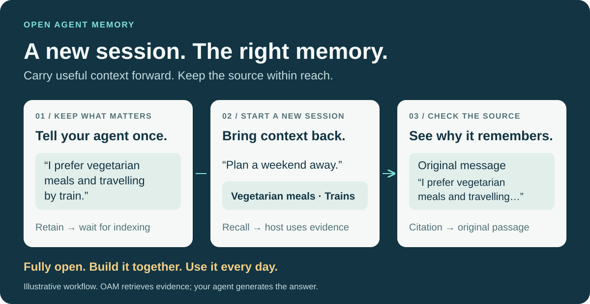
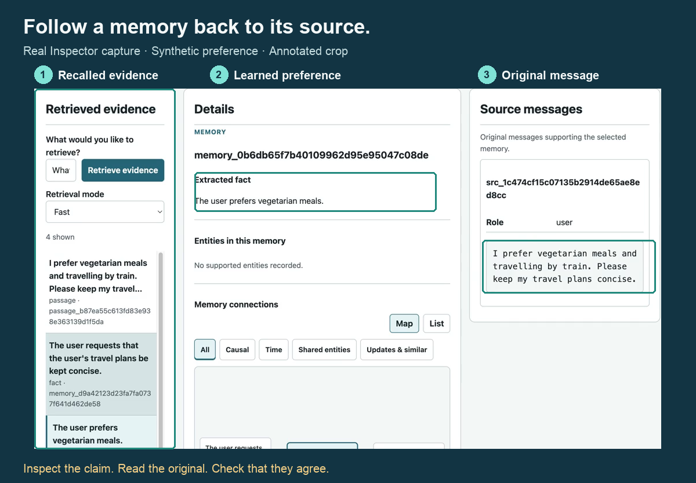

# Your first useful memory

## Overview

Run OAM, store a small preference, retrieve it with citations, then use it in a fresh agent session. OAM supplies evidence; your agent generates the answer. This guide uses the published self-hosted release and a synthetic example, so you do not need to upload a private conversation.



Already have a running OAM service and user key? Skip to [store and recall a preference](#3-store-and-recall-a-preference). To understand the data model first, see [indexing and retrieval](indexing-retrieval.md).

## 1. Run the service

You need Docker with Compose, Git, Bash, `curl`, `jq`, and working credentials for a generation model that supports text and image inputs and an OpenAI-compatible embedding endpoint. Default extraction preflight checks both text and vision, even for this text-only example. Indexing and preflight call your configured providers and may incur charges; recall uses query embeddings and does not generate the final answer. There are no default model endpoints or credentials. Setup time depends on image downloads, your machine and your providers; no fixed completion time is promised.

Clone the repository, pull the published Linux AMD64/ARM64 image, and create your private deployment settings:

```bash
git clone https://github.com/rocke2020/open-agent-memory.git
cd open-agent-memory
docker pull ghcr.io/rocke2020/open-agent-memory:0.0.2
cp deploy/.env.example deploy/.env
```

Edit `deploy/.env` before starting anything. Set each of `POSTGRES_PASSWORD`, `OAM_API_DB_PASSWORD`, `OAM_QUEUE_DB_PASSWORD`, `OAM_CONTENT_DB_PASSWORD` and `OAM_ROOT_API_KEY` to a separate random hexadecimal value; generate each with `openssl rand -hex 24`. Set `VLM_BASE_URL`, `VLM_API_KEY`, `VLM_MODEL` and `OAM_EMBEDDING_URL`, `OAM_EMBEDDING_KEY`, `OAM_EMBEDDING_MODEL` to your provider settings. Keep the file private. For a model server on your Mac, use a container-reachable address such as `host.docker.internal`, rather than `127.0.0.1`. The default embedding dimension is 1024; your endpoint must return that size, or you must set `index.embedding_dimensions` in `deploy/oam.yaml` before database initialization. OAM supports dimensions up to 2000; increasing that setting cannot enable a model with a fixed larger output. See [model protocols, reasoning settings and vector dimensions](operations.md#1-configuration) if your provider needs an operator YAML change.

The [Compose guide](../deploy/README.md#2-initialize-and-start) owns deployment and upgrade details. For this first deployment, run its initialization sequence from the repository root:

```bash
docker compose --env-file deploy/.env -f deploy/compose.yaml up -d --wait postgres
docker compose --env-file deploy/.env -f deploy/compose.yaml run migrate
docker compose --env-file deploy/.env -f deploy/compose.yaml exec -T postgres psql -U postgres -d oam -f /bootstrap/runtime-roles.sql
docker compose --env-file deploy/.env -f deploy/compose.yaml run api preflight --json
docker compose --env-file deploy/.env -f deploy/compose.yaml up -d --wait api worker
```

Stop at a failed command and resolve its error before continuing. Preflight checks your actual configured model endpoints. Open `http://127.0.0.1:17333/ui/`; a visible page confirms asset delivery, while the following steps check authorized data access and useful memory. If this port is occupied, set another `OAM_HTTP_PORT` in `deploy/.env` before startup and use that port throughout this guide.

## 2. Create your personal collection

OAM separates the administrator key from a user's key. The administrator creates a collection; the user key reads and writes its personal content. If someone else operates the service, ask them for your user ID and user key, then continue to step 3.

For your own deployment, open Bash with `bash` and run this block. Enter the root key from your private `deploy/.env` when prompted; input is hidden. It creates one new demo user and keeps its returned secret in the current shell without printing it. Choose a different `OAM_USER_ID` if `oam-demo` already exists; creating the same user again is not a key-recovery operation.

```bash
export OAM_BASE_URL='http://127.0.0.1:17333'
export OAM_USER_ID='oam-demo'
unset OAM_USER_API_KEY
read -r -s -p 'OAM administrator key: ' OAM_ADMIN_KEY
printf '\n'
user_body=$(jq -n --arg user "$OAM_USER_ID" '{user_id: $user}')
if user_receipt=$(curl --fail --silent --show-error --connect-timeout 5 --max-time 30 \
  "$OAM_BASE_URL/v1/users" \
  -H "Authorization: Bearer $OAM_ADMIN_KEY" -H 'Content-Type: application/json' \
  --data "$user_body"); then
  if OAM_USER_API_KEY=$(printf '%s' "$user_receipt" | jq -er --arg user "$OAM_USER_ID" \
    'select(.user_id == $user) | .secret | select(type == "string" and length > 0)'); then
    export OAM_USER_API_KEY
    printf 'User created. Its key is available in this Bash session.\n'
  else
    printf 'Unexpected user receipt. Stop and inspect the administrator API.\n' >&2
  fi
else
  printf 'User creation failed. Resolve the error before continuing.\n' >&2
fi
unset OAM_ADMIN_KEY user_body user_receipt
```

Continue only after **User created** appears. Store the user key privately if you want to reuse this collection after closing the shell; OAM returns the secret only once. An operator can [issue a sibling user key](api.md#2-administration) for an existing user. Never use the administrator key in a memory client or commit either key.

## 3. Store and recall a preference

In the same Bash session, run [step 2 of the HTTP quickstart](quickstart.md#2-run-the-complete-example). The connection variables are already set; no second key prompt is needed. That block retains “I prefer vegetarian meals and travelling by train. Please keep my travel plans concise,” waits for memory and links to be ready, then retrieves cited context.

Check the actual result before connecting an agent:

1. The operation reports `status: "succeeded"`, `readiness.memory_ready: true` and `readiness.links_ready: true`. An accepted receipt alone is not enough.
2. The returned `context` supports vegetarian meals, train travel and concise plans. Generated wording can vary; verify the meaning against the original message.
3. At least one returned item has source citations. Follow the relevant evidence in the Inspector and read the original text.

This first result does not wait for delayed Insights or generate a User Profile. Those are separate capabilities, explained in [indexing and retrieval](indexing-retrieval.md).

## 4. Inspect what OAM remembers

Open `http://127.0.0.1:17333/ui/`. For this Compose deployment, connect with tenant `default`, your `OAM_USER_ID` and its user key. Use **Retrieve** to ask “What are my travel and food preferences?”, select a returned memory and compare it with **Source messages**. The Inspector retrieves evidence rather than generating an answer.



This crop comes from the existing synthetic demo; it is not a capture of your new collection. Highlighted labels identify the evidence path. The [original screenshot](assets/cited-recall-demo.png) and [71-second recording](https://github.com/rocke2020/open-agent-memory/releases/download/v0.0.1/oam-v0.0.1-cited-recall-demo.mp4) show the recorded example; the recording reuses an already completed index at 2× speed.

## 5. Use the memory in a fresh agent session

Choose the client you already use. Every route connects to the service and user collection created above; installing a client package does not start OAM.

| Your client | Next step | How memory enters the session |
| --- | --- | --- |
| Claude Code or Cursor with MCP | [MCP client configuration](../integrations/mcp/README.md#client-configuration) | Tools retrieve evidence on request; the wrapper does not automatically capture every conversation |
| OpenClaw | [Plugin installation](../integrations/openclaw/README.md#npm-installation) | Configured automatic recall and eligible capture, plus explicit memory tools |
| DeepSeek Harness | [DSH plugin guide](../integrations/dsh/README.md) | Plugin recall and capture under the documented host rules |
| Your own agent over HTTP | [Retain and recall API](api.md#3-retain-and-recall) | Your application retrieves context before answering and retains eligible human input afterward |

For MCP, start a new client session after configuring the server. Ask: **“Use OAM memory to check my preferences, then suggest a concise weekend travel plan. Cite the evidence you used.”** Do not paste the preference message into that session. Confirm that the client calls `memory_recall`, the returned evidence reaches the agent, and the recommendation reflects the stored preferences. Follow its source reference in the Inspector. A correct answer without an observed recall is not evidence that the integration used OAM.

For a custom agent, pass the complete original query to `/v1/recall`, include its returned `context` as untrusted evidence in your model input, and preserve citations in the answer. The host owns the final answer, its total context budget and which completed human messages may be learned; see the [HTTP contract](api.md#3-retain-and-recall) for idempotency and operation handling.

## 6. If a step fails

| Symptom | Next action |
| --- | --- |
| Preflight fails | Inspect its named model/protocol error; check endpoints, credentials and container routing before retrying |
| `401` or `403` on memory calls | Verify the user ID and user key; the root key cannot replace them |
| Work is accepted but not ready | Inspect the existing operation and worker logs; continue checking that receipt rather than submitting duplicate input |
| Recall is empty or misses a preference | Check operation readiness, inspect the retained source and compare the actual query with its content |
| The client cannot find OAM tools | Check the client configuration, Node.js prerequisite for MCP and the service URL; restart the client session |
| The answer ignores stored preferences | Inspect the actual recall/tool result and whether it reached the host's model input |
| User Profile is empty | First recall does not generate it; [refresh the Profile explicitly](memory-web-ui.md#3-use-the-views) when needed |

For operator errors, see [operations](operations.md). If you need help, open a repository issue with your OAM/client versions, the failing step, operation or request ID and a sanitized error. Keep credentials and private conversation text out of the report. Once the synthetic example works, try one real task and repeat it in another session before judging whether OAM helps your agent.
