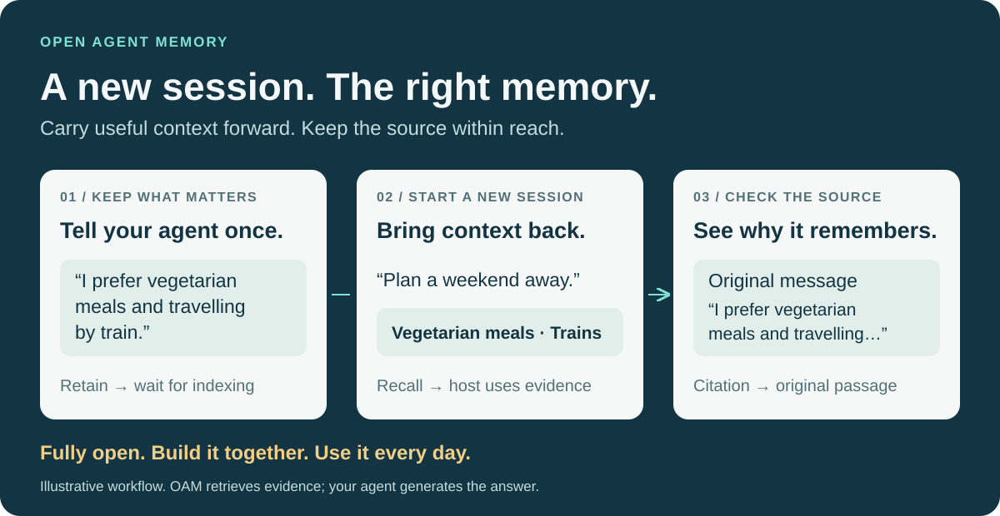
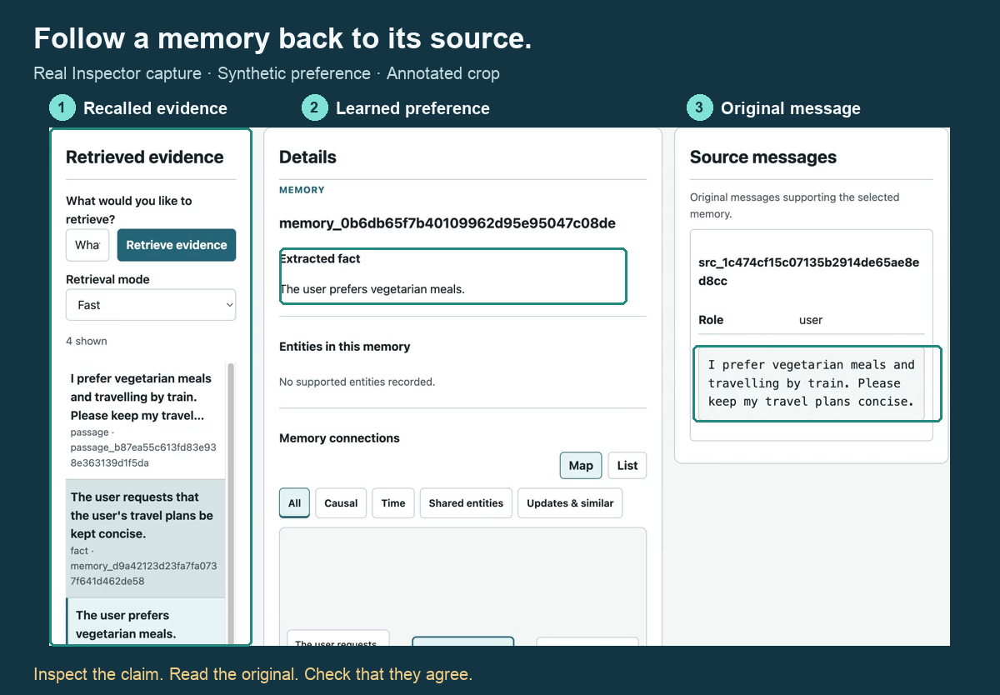

# 第一条有用的记忆

[中文文档](README.md) · [English](../start-here.md)

## 概述

启动 OAM，保存一条简单偏好，召回带引用的证据，然后在新的 Agent 会话中使用这条记忆。OAM 提供证据，你的 Agent 生成答案。本指南使用 v0.2.1 自托管镜像和演示数据，无需上传私人会话。镜像的验证与发布情况见[发布记录（英文）](../releases/0.2.1.md)。



已有运行中的 OAM 服务和用户密钥，可直接[保存并召回一项偏好](#3-保存并召回一项偏好)。数据表示见[索引与检索](indexing-retrieval.md)。

## 1. 启动服务

需要 Docker Compose、Git、Bash、`curl`、`jq`，以及支持文本和图像输入的生成模型和兼容 OpenAI 的向量端点。即便示例仅含文本，默认抽取模型预检仍会检查文本和视觉能力。索引和预检调用你配置的端点，可能产生费用。普通召回会使用查询向量，答案由应用生成。OAM 未预置模型端点或凭据；安装时间取决于镜像下载、机器和服务商。

克隆仓库，拉取 Linux AMD64 或 ARM64 镜像，创建私有配置文件。

```bash
git clone https://github.com/rocke2020/open-agent-memory.git
cd open-agent-memory
docker pull ghcr.io/rocke2020/open-agent-memory:0.2.1
cp deploy/.env.example deploy/.env
```

启动前编辑 `deploy/.env`。为 `POSTGRES_PASSWORD`、`OAM_API_DB_PASSWORD`、`OAM_QUEUE_DB_PASSWORD`、`OAM_CONTENT_DB_PASSWORD` 和 `OAM_ROOT_API_KEY` 分别设置独立的随机十六进制值，可逐个使用 `openssl rand -hex 24` 生成。按服务商配置填写 `VLM_BASE_URL`、`VLM_API_KEY`、`VLM_MODEL`、`OAM_EMBEDDING_URL`、`OAM_EMBEDDING_KEY` 和 `OAM_EMBEDDING_MODEL`。请妥善保管该文件。若模型服务运行在 Mac 上，使用容器可访问的地址，例如 `host.docker.internal`。默认向量维度为 1024，支持的最大维度为 2000。模型返回其他受支持的维度时，先在 `deploy/oam.yaml` 设置 `index.embedding_dimensions`，再初始化数据库。见[模型配置](operations.md#1-配置)。

从仓库根目录执行初始化命令，部署和升级细节见 [Compose 指南](../../deploy/README_CN.md#2-初始化和启动)。

```bash
docker compose --env-file deploy/.env -f deploy/compose.yaml up -d --wait postgres
docker compose --env-file deploy/.env -f deploy/compose.yaml run migrate
docker compose --env-file deploy/.env -f deploy/compose.yaml exec -T postgres psql -U postgres -d oam -f /bootstrap/runtime-roles.sql
docker compose --env-file deploy/.env -f deploy/compose.yaml run api preflight --json
docker compose --env-file deploy/.env -f deploy/compose.yaml up -d --wait api worker
```

任何一步失败时，先解决报错再继续。预检会实际调用你配置的模型。打开 `http://127.0.0.1:17333/ui/` 检查页面能否加载。接下来的步骤会验证用户授权、数据访问和召回结果。若端口已被占用，启动前在 `deploy/.env` 修改 `OAM_HTTP_PORT`，并在后续步骤使用该端口。

## 2. 创建个人记忆集合

管理员密钥用于创建用户，用户密钥用于访问对应的个人内容。若他人负责部署，请向其获取服务 URL、用户 ID 和用户密钥，按 [HTTP 快速开始](quickstart.md#1-准备连接)设置 `OAM_BASE_URL`、`OAM_USER_ID` 和 `OAM_USER_API_KEY`，然后继续第 3 步。

如果你自行部署，在 Bash 中运行下面的命令块。按提示输入 `deploy/.env` 中的管理员密钥，终端不会回显。命令会创建演示用户，将首次返回的用户密钥保留在当前终端环境中。如果 `oam-demo` 已存在，请换一个 `OAM_USER_ID`。已存在用户可以通过管理 API 签发新的用户密钥。

```bash
export OAM_BASE_URL='http://127.0.0.1:17333'
export OAM_USER_ID='oam-demo'
unset OAM_USER_API_KEY
read -r -s -p 'OAM administrator key: ' OAM_ADMIN_KEY
printf '\n'
user_body=$(jq -n --arg user "$OAM_USER_ID" '{user_id: $user}')
if user_receipt=$(curl --fail --silent --show-error --connect-timeout 5 --max-time 30 \
  "$OAM_BASE_URL/v1/users" \
  -H "Authorization: Bearer $OAM_ADMIN_KEY" -H 'Content-Type: application/json' \
  --data "$user_body"); then
  if OAM_USER_API_KEY=$(printf '%s' "$user_receipt" | jq -er --arg user "$OAM_USER_ID" \
    'select(.user_id == $user) | .secret | select(type == "string" and length > 0)'); then
    export OAM_USER_API_KEY
    printf 'User created. Its key is available in this Bash session.\n'
  else
    printf 'Unexpected user receipt. Stop and inspect the administrator API.\n' >&2
  fi
else
  printf 'User creation failed. Resolve the error before continuing.\n' >&2
fi
unset OAM_ADMIN_KEY user_body user_receipt
```

看到 **User created** 后继续。如果关闭终端后仍需使用此集合，请私下保存只返回一次的用户密钥。管理员可以[另行签发用户密钥](api.md#2-管理)。请勿将管理员密钥用于记忆客户端，或把任何密钥提交至仓库。

## 3. 保存并召回一项偏好

在同一 Bash 会话中执行 [HTTP 示例](quickstart.md#2-运行完整示例)。连接变量已设置，无需再次输入密钥。示例保存偏好 “I prefer vegetarian meals and travelling by train. Please keep my travel plans concise.”，等待记忆和关联就绪，再召回带引用的上下文。

接入 Agent 前检查结果。

1. 操作返回 `status: "succeeded"`，而且 `readiness.memory_ready` 和 `readiness.links_ready` 均为 `true`。收到任务回执表示系统已经接收请求。
2. 返回的 `context` 支持素食、乘火车旅行和行程简洁三项偏好。抽取文字可能有差异，请对照原始消息核对含义。
3. 至少一个返回项包含来源引用。在 Inspector 中打开对应证据，阅读原文。

延迟生成的洞察和个人画像另有独立处理流程。见[索引与检索](indexing-retrieval.md)。

## 4. 检查 OAM 记住的内容

打开 `http://127.0.0.1:17333/ui/`。使用租户 `default`、你的 `OAM_USER_ID` 和用户密钥连接。在 **Retrieve（召回）** 输入 “What are my travel and food preferences?”，选中一条返回记忆，并与 **Source messages（来源消息）** 对照。



截图使用另一套演示数据，并标注了证据路径。[原始截图](../assets/cited-recall-demo.png)和 [71 秒录屏](https://github.com/rocke2020/open-agent-memory/releases/download/v0.0.1/oam-v0.0.1-cited-recall-demo.mp4)展示了该示例，录屏以两倍速复用了已经完成的索引。

## 5. 在新的 Agent 会话中使用记忆

选择你已有的客户端。下列客户端都连接到前面已创建的服务和个人集合，服务由部署步骤启动。

| 客户端 | 接入指南 | 记忆如何进入会话 |
| --- | --- | --- |
| Claude Code 或 Cursor（MCP） | [MCP 客户端配置](../../integrations/mcp/README_CN.md#通过发布归档安装) | Agent 按需调用工具召回证据。采集由宿主控制 |
| OpenClaw | [插件安装](../../integrations/openclaw/README_CN.md#通过发布归档安装) | 按配置自动召回或采集符合条件的内容，另有显式记忆工具 |
| DeepSeek Harness | [DSH 插件](../../integrations/dsh/README_CN.md#通过发布归档安装) | 按宿主规则执行插件召回和采集 |
| 自定义 HTTP Agent | [保存与召回 API](api.md#3-保存与召回) | 应用在回答前召回，在会话结束后保留符合要求的用户输入 |

配置 MCP 后，新建客户端会话，输入 **“Use OAM memory to check my preferences, then suggest a concise weekend travel plan. Cite the evidence you used.”**。不要在该会话中粘贴偏好原文。确认客户端调用了 `memory_recall`，返回证据确实提供给 Agent，回答也符合已保存的偏好。然后在 Inspector 核对其引用的原始来源。

如果你自己接入 API，请将完整原始查询传给 `/v1/recall`，将返回的 `context` 作为不可信证据提供给模型，并保留答案中的引用。宿主负责回答、总输入预算，以及判断哪些已完成的人工消息允许学习。幂等和操作状态见 [HTTP API](api.md#3-保存与召回)。

## 6. 排查问题

| 现象 | 处理方式 |
| --- | --- |
| 预检失败 | 检查具体模型和协议报错，再核对端点、凭据和容器网络 |
| 个人内容 API 返回 `401` 或 `403` | 核对用户 ID 和用户密钥，个人路由需要用户授权 |
| 请求已接收但内容未就绪 | 查看原有操作和工作进程日志，避免重复提交输入 |
| 召回为空或遗漏某项偏好 | 核对操作就绪状态，查看原文并比较实际查询内容 |
| 客户端找不到 OAM 工具 | 核对客户端配置、MCP 的 Node.js 要求和服务 URL，再重启客户端会话 |
| 回答忽略已保存偏好 | 检查实际召回或工具结果，以及结果是否进入宿主模型输入 |
| 用户画像为空 | 初次召回不会触发画像生成，需要时在 [Inspector 手动刷新](memory-web-ui.md#3-使用各视图) |

更多运维排查见[运维](operations.md)。提交问题时提供 OAM 和客户端版本、出错步骤、操作 ID 或请求 ID 与脱敏报错。示例成功后，可以用一个真实任务在不同会话中再次验证记忆是否有帮助。
